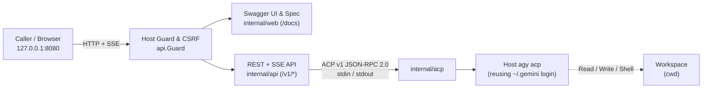

# agyd

`agyd` exposes an installed Antigravity CLI (`agy`) as a local HTTP and Server-Sent Events (SSE) API with interactive Swagger documentation. It bridges HTTP requests to a warm `agy acp` (Agent Client Protocol v1 over stdio) child process on the host and reuses your existing `~/.gemini` login.



## Quick start

The standard build and verification commands:

```bash
go build ./cmd/agyd
go run ./cmd/agyd
go vet ./... && go test -race ./...
```

These commands match `AGENTS.md` § Setup Commands; verification tiers are detailed in `GUIDE-testing` (`fyr record get GUIDE-testing`).

## Install and run

Install `agyd` into `$GOPATH/bin`:

```bash
go install ./cmd/agyd
```

Or build the binary directly:

```bash
go build -o agyd ./cmd/agyd
```

Prerequisites:
- `agy` CLI installed on your `$PATH` (or specified via `-agy`).
- An active `~/.gemini` login. If you have not logged in yet, run `agy` once interactively on the host. `agyd` requires no login command.

Start the daemon:

```bash
agyd
```

By default, `agyd` listens on `http://127.0.0.1:8080` and uses your current working directory as the default workspace.

## Browser documentation

Open `http://127.0.0.1:8080/docs` in your browser (navigating to `http://127.0.0.1:8080/` redirects to `/docs`).

`agyd` serves vendored Swagger UI assets from memory and provides the OpenAPI 3.1 specification at `GET /openapi.json`. You can use Swagger UI's **Try it out** feature as your primary manual testing surface.

## Curl and jq examples

### Check status

```bash
curl -fsS http://127.0.0.1:8080/v1/status | jq .
```

### Create a session

```bash
SESSION_ID="$(curl -fsS -X POST http://127.0.0.1:8080/v1/sessions \
  -H "Content-Type: application/json" \
  -d "{\"cwd\":\"$(pwd)\"}" | jq -r .sessionId)"
```

### Buffered prompt turn (JSON)

Returns aggregated text output once the turn completes:

```bash
curl -fsS -X POST "http://127.0.0.1:8080/v1/sessions/$SESSION_ID/prompt" \
  -H "Content-Type: application/json" \
  -d '{"prompt":"Summarize this repository in two sentences."}' | jq -r .text
```

### Streamed prompt turn (SSE)

Streams real-time session update events as the agent works:

```bash
curl -N -s -X POST "http://127.0.0.1:8080/v1/sessions/$SESSION_ID/prompt" \
  -H "Accept: text/event-stream" \
  -H "Content-Type: application/json" \
  -d '{"prompt":"List top-level directories."}' \
  | sed -un 's/^data: //p' | jq .
```

## Security and permission policy

> [!WARNING]
> By default, `agyd` runs with `-permission-policy allow_all`. Tool execution requests from the agent (shell execution, file writes) are approved automatically. To require manual approval rejection on all agent permission requests, pass `-permission-policy deny_all`.

- **Loopback binding:** `agyd` strictly requires a loopback address (`127.0.0.1`, `localhost`, or `::1`). Non-loopback addresses or wildcards (such as `0.0.0.0`) are rejected at startup.
- **Host guard:** The outer HTTP mux validates the `Host` header and returns `403 Forbidden` (`FORBIDDEN_HOST`) for any non-loopback host names, preventing DNS rebinding.
- **CSRF protection:** All incoming mutating requests are protected by standard library `http.CrossOriginProtection` against cross-site requests.
- **No in-app token:** Access control is enforced by loopback isolation, Host header verification, and CSRF protection.

## Configuration

Flags and environment variables read by `cmd/agyd`:

| Setting | Flag | Env var | Default |
|---|---|---|---|
| Listen address | `-addr` | `AGYD_ADDR` | `127.0.0.1:8080` (must be loopback) |
| ACP agent binary | `-agy` | `AGYD_AGY` | `agy` |
| ACP arguments | `-acp-args` | `AGYD_ACP_ARGS` | `acp` |
| Default workspace | `-workspace` | `AGYD_WORKSPACE` | Current working directory (`os.Getwd()`) |
| Permission policy | `-permission-policy` | `AGYD_PERMISSION_POLICY` | `allow_all` (`allow_all` or `deny_all`) |

## Deploy

Local host execution only — see `DEPLOY-local` (`fyr record get DEPLOY-local`). Releases pass through `/fyr-preflight`.

## Where things are

- Architecture and design: [SDD.md](SDD.md) and [TDD.md](TDD.md)
- Decisions: `fyr record list --kind adr` (`ADR-001`, `ADR-002`)
- Surface specification: `fyr record get SPEC-agy-api-acp-gateway`
- Verification procedures: `fyr record get GUIDE-testing`
- Changes and bugs: `fyr record list --kind change`, `fyr record list --kind bug`
