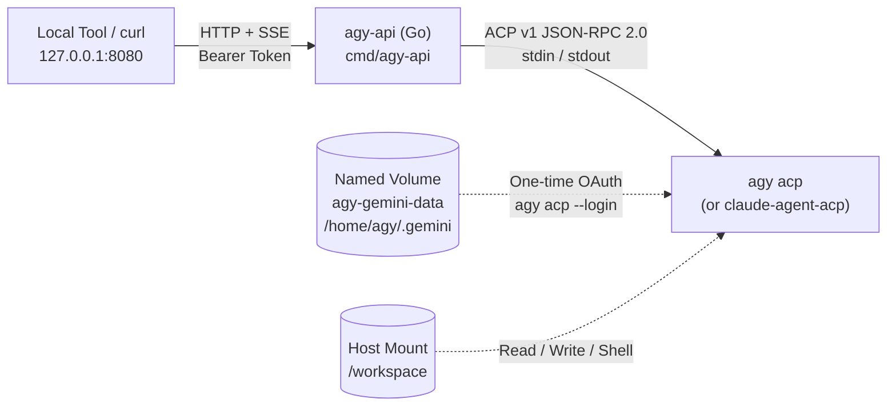

# agy-api

`agy-api` exposes the Antigravity CLI (`agy`) as a local HTTP + Server-Sent Events (SSE) API by bridging REST calls to a warm `agy acp` (Agent Client Protocol v1 over stdio) child process inside a Docker container, with one-time credential ingestion in a named volume.



## Quick start

```bash
go build ./cmd/agy-api
go run ./cmd/agy-api
go vet ./... && go test -race ./...
```

The same commands are the contract in `AGENTS.md` § Setup Commands; the `GUIDE-testing` record (`fyr record get GUIDE-testing`) defines the verification tiers behind them.

## Container workflow (one-time credential ingestion)

1. Start Colima (if not already running) and build the container image:
   ```bash
   colima status || colima start
   docker compose build
   ```
2. Ingest `agy` OAuth credentials once into the persistent `agy-gemini-data` volume:
   ```bash
   docker compose run --rm agy-api agy acp --login
   ```
3. Start the API gateway on `http://127.0.0.1:8080`:
   ```bash
   AGY_API_TOKEN=dev-secret-token docker compose up -d
   ```
4. Create a session and stream a prompt turn over SSE:
   ```bash
   curl -sS -X POST http://127.0.0.1:8080/v1/sessions \
     -H "Authorization: Bearer dev-secret-token" \
     -H "Content-Type: application/json" \
     -d '{"cwd":"/workspace"}'

   curl -N -X POST http://127.0.0.1:8080/v1/sessions/<SESSION_ID>/prompt \
     -H "Authorization: Bearer dev-secret-token" \
     -H "Accept: text/event-stream" \
     -H "Content-Type: application/json" \
     -d '{"prompt":"Summarize this repository in two sentences."}'
   ```

## Architecture

`cmd/agy-api` starts an HTTP server on port `8080` and supervises an ACP v1 child process (`agy acp --dangerously-skip-permissions` by default inside the container). `internal/acp` multiplexes JSON-RPC 2.0 calls over `stdin`/`stdout`, routes `session/update` notifications to the active caller, and answers `session/request_permission` callbacks according to policy. `internal/api` enforces bearer-token authentication and streams updates as SSE (`text/event-stream`) or aggregated JSON (`application/json`).

```
cmd/agy-api/      # the binary: flags, env config, wiring, graceful shutdown
internal/acp/     # ACP v1 JSON-RPC 2.0 stdio client, session registry, permission policy
internal/api/     # HTTP/SSE routes, bearer auth middleware, AIP-193 JSON errors
.agents/          # project customizations and scratch/ (trail records live in fyr's brain store)
```

## Configuration

Flags and environment variables read by `cmd/agy-api`, with their defaults:

| Setting | Flag / env | Default |
|---|---|---|
| Listen address | `-addr` / `AGY_API_ADDR` (or `PORT`) | `127.0.0.1:8080` (`:8080` when `PORT` is set) |
| Bearer token | `AGY_API_TOKEN` | None (required unless `-allow-unauthenticated` is set) |
| ACP binary | `-acp-bin` / `AGY_ACP_BIN` | `agy` |
| ACP arguments | `-acp-args` / `AGY_ACP_ARGS` | `acp` |
| Default workspace | `-workspace` / `AGY_WORKSPACE` | `/workspace` |
| Permission policy | `-permission-policy` / `AGY_PERMISSION_POLICY` | `allow_all` |
| Allow unauthenticated | `-allow-unauthenticated` / `AGY_ALLOW_UNAUTHENTICATED` | `false` |

## Deploy

How it runs locally is recorded in `DEPLOY-local` (`fyr record get DEPLOY-local`); a release goes through `/fyr-preflight`.

## Where things are

Decisions: `fyr record list --kind adr`. Surface contract: `fyr record get SPEC-agy-api-acp-gateway`. What changed: `--kind change`. What went wrong and the rule that came out of it: `--kind bug`. The next session starts from the newest handoff, `fyr record list --kind handoff`.
