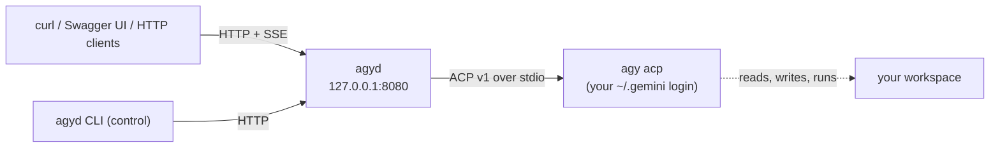
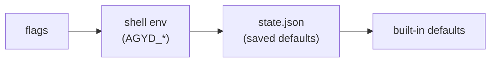

# agyd

**A minimal HTTP + Server-Sent Events (SSE) API and Swagger UI in front of the `agy` CLI you already have installed.** Run `agyd` to expose a local REST/SSE wrapper over `agy acp` with interactive docs at `http://127.0.0.1:8080/docs`, plus a thin control-plane CLI for managing conversations, models, and defaults. It reuses your existing `~/.gemini` login — no Docker, no API keys, and no extra setup.



## Quick start

Start `agyd` in your project folder and send your first prompt over HTTP in under a minute. You need **Go 1.27+** and a working **`agy`** binary on your `PATH`, already signed in (if `agy` runs interactively in your terminal, you are set).

1. Build `agyd` and start it from the workspace folder you want the agent to use:

   ```bash
   gh repo clone kesokaj/agyd && cd agyd
   go build -o bin/ ./cmd/agyd    # writes bin/agyd
   export PATH="$PWD/bin:$PATH"   # or copy bin/agyd to a folder on your PATH
   cd ~/code/my-project           # the folder the agent should work in
   agyd
   ```

   The first time you run `agyd` in a terminal, it asks which model and thinking level to use and offers to save them as your defaults. Press Enter to accept `agy`'s default.

2. Prompt the server immediately from a **second terminal** with `curl`:

   ```bash
   curl -fsS -X POST http://127.0.0.1:8080/v1/prompt \
     -H 'Content-Type: application/json' \
     -d '{"prompt": "Summarize this repository in two sentences."}' | jq -r .text

   # Follow up in the same current conversation (it remembers)
   curl -fsS -X POST http://127.0.0.1:8080/v1/prompt \
     -H 'Content-Type: application/json' \
     -d '{"prompt": "Now list its top-level directories."}' | jq -r .text
   ```

Prefer a browser? Open **http://127.0.0.1:8080/docs** and click **Try it out** under any endpoint.

> [!IMPORTANT]
> The agent works in the folder you start `agyd` from, unless you set `-workspace` or start a conversation elsewhere (`agyd new` uses the folder you run it from). `agyd` runs one `agy acp` process per active workspace folder (started on the first conversation there and stopped when its last live conversation closes), keeping each folder's workspace roots isolated. By default it approves its own tool calls (file writes, shell commands). See [Safety](#safety).

## HTTP API

`agyd` exposes a strict, verbatim ACP v1 wrapper over buffered JSON and streaming SSE, alongside endpoints for conversations, models, and saved defaults. Every client — `curl`, scripts, Swagger UI, and the `agyd` control-plane CLI — calls the same `/v1/*` API.

### Prompt (buffered JSON)

Send a prompt to `POST /v1/prompt` (the current conversation, auto-created if none exists) or `POST /v1/conversations/{id}/prompt` (a specific live conversation):

```bash
curl -fsS -X POST http://127.0.0.1:8080/v1/prompt \
  -H 'Content-Type: application/json' \
  -d '{"prompt": "Summarize this repository in two sentences."}' | jq -r .text
```

The JSON response wraps ACP v1 verbatim rather than inventing a custom item schema, returning `conversationId`, `model`, `thinkingLevel`, `mode`, `stopReason`, `usage`, `text`, and `updates`:

- **`.text`** — the verbatim concatenation of ACP `agent_message_chunk` text chunks, never stripped or rewritten.
- **`.updates`** — **always** a JSON array (`[]` when empty, never `null` and never omitted) containing the verbatim ACP v1 `session/update` objects in arrival order (thoughts, tool calls, tool updates, and message chunks).

### Stream live (SSE)

Add `Accept: text/event-stream` to `POST /v1/prompt` or `POST /v1/conversations/{id}/prompt` to stream events while the agent works:

```bash
curl -N -sS -X POST http://127.0.0.1:8080/v1/prompt \
  -H 'Accept: text/event-stream' -H 'Content-Type: application/json' \
  -d '{"prompt": "List the top-level directories."}'
```

| Event | When | `data` |
|---|---|---|
| `session_update` | Every ACP update in arrival order | Verbatim ACP v1 `session/update` object (text, thoughts, tool calls) |
| `prompt_done` | The turn finished | Same shape as buffered JSON, **without** `updates` |
| `prompt_error` | The turn failed | AIP-193 error object |

### Visibility headers

Every `/healthz` and `/v1/*` response names the current conversation in HTTP headers (omitted when none is set):

```text
Agyd-Conversation: 2652ba62-...
Agyd-Model: gemini-4-carbon
Agyd-Thinking-Level: high
Agyd-Mode: default
```

### Fixed conversations for scripts

The current conversation is shared by every client. A script that must stay isolated from `agyd use` elsewhere creates its own conversation with `"use": false`, addresses it by ID, and deletes it when finished:

```bash
ID=$(curl -fsS -X POST http://127.0.0.1:8080/v1/conversations \
  -H 'Content-Type: application/json' \
  -d '{"cwd": "/Users/me/code/other", "model": "gemini-4-carbon", "use": false}' | jq -r .conversationId)
curl -fsS -X POST "http://127.0.0.1:8080/v1/conversations/$ID/prompt" \
  -H 'Content-Type: application/json' -d '{"prompt": "hi"}' | jq -r .text
curl -X DELETE "http://127.0.0.1:8080/v1/conversations/$ID"
```

`"use": false` leaves the current conversation untouched. Each conversation handles **one turn at a time**: a second prompt or model change while a turn runs returns `409 PROMPT_IN_FLIGHT`.

### Endpoints and errors

Browse the full interactive contract at `GET /docs` (Swagger UI) or fetch the OpenAPI 3.1 document at `GET /openapi.json`.

> [!NOTE]
> Before ADR-005 these paths were `/v1/sessions/...` with a `sessionId` field. They are now `/v1/conversations/...` and `conversationId`; the old paths return `404`.

<details>
<summary>All HTTP endpoints (21 routes)</summary>

| Method | Path | What it does |
|---|---|---|
| `GET` | `/docs` | Swagger UI (`/` redirects here) |
| `GET` | `/openapi.json` | OpenAPI 3.1 spec for client generators |
| `GET` | `/healthz` | Liveness and service identity: `200` `{"service":"agyd"}` |
| `GET` | `/v1/status` | Agent readiness, version, policy, workspace |
| `GET` | `/v1/current` | The current conversation (`404` if none) |
| `PATCH` | `/v1/current` | Change its `model`, `thinkingLevel`, or `mode` |
| `POST` | `/v1/prompt` | Run a turn on the current conversation (creates one if needed): buffered JSON, or SSE with `Accept: text/event-stream` |
| `POST` | `/v1/cancel` | Cancel the current conversation's running turn |
| `POST` | `/v1/clear` | Start a new current conversation with the current one's folder and settings (old stays in history) |
| `POST` | `/v1/conversations` | Create one (`cwd`, `model`, `thinkingLevel`, `mode`, `use`; all optional). Becomes current unless `"use": false` |
| `GET` | `/v1/conversations` | List live conversations and `agy`'s history, newest first (`?cwd=` filters) |
| `GET` | `/v1/conversations/{id}` | One conversation |
| `PATCH` | `/v1/conversations/{id}` | Change its settings |
| `DELETE` | `/v1/conversations/{id}` | End it (`204`). Ending the current one clears the pointer |
| `POST` | `/v1/conversations/{id}/prompt` | Run a turn on that conversation (buffered JSON or SSE) |
| `POST` | `/v1/conversations/{id}/cancel` | Cancel its running turn |
| `POST` | `/v1/conversations/{id}/use` | Make it current (resumes it if it is not live) |
| `POST` | `/v1/conversations/{id}/clear` | Start a new current conversation with `{id}`'s folder and settings (old stays in history) |
| `GET` | `/v1/models` | Models, thinking levels, and modes `agy` offers |
| `GET` | `/v1/defaults` | Defaults for new conversations |
| `PUT` | `/v1/defaults` | Change the defaults and save them to `state.json` |

</details>

<details>
<summary>Errors (AIP-193 shape and status codes)</summary>

Every error has the same shape (Google AIP-193):

```json
{"error": {"code": 409, "status": "ABORTED", "message": "a prompt turn is in flight for this conversation", "details": [{"@type": "type.googleapis.com/google.rpc.ErrorInfo", "reason": "PROMPT_IN_FLIGHT", "domain": "agyd.local"}]}}
```

| HTTP | Reason | Meaning |
|---|---|---|
| 400 | `MALFORMED_BODY`, `INVALID_CWD`, `INVALID_SETTING` | Bad JSON or trailing data after the JSON value; `cwd` is not a clean absolute path of an existing real directory, contains a symlink (the error names the real path), or is inside `.gemini` (in any letter case); a model, thinking level, or mode `agy` does not offer |
| 401 | `ACP_AUTH_REQUIRED` | `agy` is not signed in. Run `agy` once, or `agy acp --login` |
| 403 | `FORBIDDEN_HOST`, `CROSS_ORIGIN_REQUEST` | The request's `Host` header is not an address `agyd` accepts (loopback, or with `-host` this machine's IPs and hostname); a browser sent a cross-origin write |
| 404 | `NOT_FOUND`, `CONVERSATION_NOT_FOUND`, `NO_CURRENT_CONVERSATION` | Unknown path; unknown or ended conversation; or nothing is current yet |
| 405 | `METHOD_NOT_ALLOWED` | Known path (API or web), wrong method. The `Allow` header lists the right ones |
| 409 | `PROMPT_IN_FLIGHT` | That conversation is running a turn |
| 413 | `BODY_TOO_LARGE` | The request body is over 1 MiB |
| 502 | `ACP_RPC_ERROR`, `ACP_PROCESS_EXITED` | `agy` returned an error or exited. It restarts on the next call |
| 503 | `MODELS_UNKNOWN` | `agyd` has not seen `agy`'s model list yet (no conversation started) |

</details>

## Conversations

`agyd` maintains one **current conversation** across restarts, and the `agyd` CLI provides a thin control plane backed 1:1 by `/v1/*` to inspect and manage conversations, models, and saved defaults. Send prompts over HTTP (`POST /v1/prompt` or `/docs`) rather than the CLI; every control-plane subcommand prints readable table or text output by default, writes the active conversation summary to `stderr`, and accepts `--json` for scripts.

| Task | CLI | HTTP |
|---|---|---|
| Show the current conversation | `agyd current` | `GET /v1/current` |
| List all conversations (`*` marks current) | `agyd list` | `GET /v1/conversations` |
| Start fresh in this folder | `agyd new [--model M] [--thinking T] [--mode X]` | `POST /v1/conversations` |
| Switch to another conversation | `agyd use <id>` | `POST /v1/conversations/{id}/use` |
| Clear context (same folder and settings) | `agyd clear [<id>]` | `POST /v1/clear`, `POST /v1/conversations/{id}/clear` |
| Change model, thinking, or mode now | `agyd model [<family>] [--thinking T] [--mode X]` | `PATCH /v1/current` |
| See what `agy` offers | `agyd models` | `GET /v1/models` |
| View or save defaults to `state.json` | `agyd defaults [--model M] [--thinking T] [--mode X]` | `GET /v1/defaults`, `PUT /v1/defaults` |

`agyd list` shows every `agy` conversation on this machine, including sessions from the IDE or the `agy` CLI, and `agyd use` resumes any of them. Run `agyd help` to list every control-plane command and its shared flags (`--json`, `--host`, `--port`).

```bash
agyd new --model claude-sonnet-5-5 --thinking low
agyd model gemini-4-carbon --thinking high     # same conversation, new model
agyd list
agyd current --json
```

## Configuration

Server settings resolve from CLI flags, `AGYD_*` shell environment variables, saved defaults in `state.json`, and built-in defaults, with the highest layer winning. Startup flags and environment variables override saved defaults for the running process without overwriting `state.json` on disk.



| Flag | Env var | Default | What it does |
|---|---|---|---|
| `-model` | `AGYD_MODEL` | `agy`'s default | Model for new conversations, for example `gemini-4-carbon` (`agyd models` lists them) |
| `-thinking` | `AGYD_THINKING` | `agy`'s default | Thinking level: `low`, `medium`, or `high` |
| `-mode` | `AGYD_MODE` | `agy`'s default | Agent mode: `default`, `accept-edits`, or `plan` |
| `-no-prompt` | `AGYD_NO_PROMPT` | `false` | Never ask for the model at startup |
| `-host` | `AGYD_HOST` | `127.0.0.1` | Listen address: an IP or `localhost`. `0.0.0.0` listens on all IPv4 interfaces, `::` on all IPv6 ones (see [Safety](#safety)) |
| `-port` | `AGYD_PORT` | `8080` (then `3000`) | Listen port (falls back to `3000` when unset and `8080` is taken; explicit port never falls back) |
| `-workspace` | `AGYD_WORKSPACE` | current folder | Default folder for new conversations (real path, no symlinks) |
| `-state-dir` | `AGYD_STATE_DIR` | `~/.config/agyd` | Directory holding `state.json` (must be absolute) |
| `-permission-policy` | `AGYD_PERMISSION_POLICY` | `allow_all` | `allow_all` or `deny_all` for agent tool calls |
| `-log-level` | `AGYD_LOG_LEVEL` | `info` | Log level: `debug`, `info`, `warn`, or `error` (case-insensitive) |
| `-agy` | `AGYD_AGY` | `agy` | Path to the `agy` binary |
| `-acp-args` | `AGYD_ACP_ARGS` | `acp` | Space-separated arguments forwarded to the `agy` binary |

- **`-log-level` / `AGYD_LOG_LEVEL`:** defaults to `info`. Configures structured JSON logging to `stdout` (`debug`, `info`, `warn`, or `error`; case-insensitive). Any invalid value exits 1 immediately with a `"configuration error"` log message.
  - **`INFO` (default):** logs startup `settings` (including `logLevel`), `/v1/*` and error (`4xx`/`5xx`) `"http request"` access logs (`method`, `path`, `status`, `durationMs`, optional `conversationId`, `canceled`), metadata-only `"prompt started"` and `"prompt finished"` turn events (`conversationId`, `model`, `thinkingLevel`, `mode`, `stream`, `stopReason`, `durationMs`, `updates`, `totalTokens`), conversation lifecycle events (`conversation created`, `conversation cleared`, `conversation switched`, `conversation updated`, `conversation deleted`, `defaults updated`), and ACP subprocess lifecycle (`acp process started`, `acp process stopped`, `acp process exited unexpectedly` at `WARN`).
  - **`DEBUG`:** additionally emits `2xx`/`3xx` quiet-route access logs (`/healthz`, `/`, `/docs`, `/openapi.json`, `/static/*`) and raw child `acp stderr` output (capped at 4 KiB/line, suppressed at default `info`); `-log-level debug` is intended for temporary local troubleshooting only.
  - **Strict privacy rule:** prompt text, reply text, tool-call arguments, query strings, and raw ACP `session/update` payloads are never logged at any level.
- **`-acp-args` / `AGYD_ACP_ARGS`:** defaults to `acp`. Space-separated arguments forwarded directly to the `agy` binary — for example, `agyd -acp-args "acp --..."` when you need to pass extra flags to `agy`.
- **`state.json`:** lives in `AGYD_STATE_DIR` (must be an absolute path when set), else `$XDG_CONFIG_HOME/agyd/` (when absolute), else `~/.config/agyd/`. It is flat, holding `currentConversationId`, `defaults` (`model`, `thinkingLevel`, `mode`), and `conversations` (remembered folders and settings). It is written atomically via temp file + sync + rename with mode `0600` (directory `0700`) and read non-blocking (`O_NONBLOCK`) as a regular file capped at 4 MiB.
- **Saved defaults:** written to `state.json` by the startup question, `agyd defaults --model ...`, and `PUT /v1/defaults`. Startup flags or environment variables override saved defaults for the running process without overwriting `state.json` on disk.
- **The startup question:** appears only in an interactive terminal when no flag, environment variable, or saved default sets a model. `-no-prompt`, or starting without a terminal, skips the question and uses `agy`'s default.
- **CLI server discovery:** the CLI finds the server through `--host`/`--port`, then `AGYD_URL`, then `AGYD_HOST`/`AGYD_PORT` in your shell; otherwise it probes `GET /healthz` on `8080` then `3000`, accepting only `200` JSON `{"service":"agyd"}` (neither `config.env` nor `./.env` are read). `0.0.0.0` and `::` dial loopback.

```bash
agyd -port 9090 -workspace ~/code/sandbox -permission-policy deny_all
agyd current --port 9090
curl -fsS -X POST http://127.0.0.1:9090/v1/prompt \
  -H 'Content-Type: application/json' -d '{"prompt": "hello"}' | jq -r .text
```

### Reaching agyd from another device

Start `agyd` bound to all interfaces:

```bash
agyd -host 0.0.0.0 -port 8080
```

Then open `http://<your-machine-ip>:8080/docs` from the other device, call `POST http://<your-machine-ip>:8080/v1/prompt` with `curl`, or run `agyd current --host <your-machine-ip>` there. At startup `agyd` logs a warning listing the addresses it accepts: your machine's IPs and its hostname. macOS may ask whether to allow incoming connections.

### Running in a container

To run `agyd` inside a container:

- **Configure via `AGYD_*` env vars:** set `AGYD_HOST=0.0.0.0` to accept external traffic, configure `AGYD_STATE_DIR=/data/state`, and provide any model or mode flags. Non-TTY stdin automatically skips the startup picker. Logs stream as structured JSON on stdout, and `SIGTERM` stops the server cleanly with state already synced to disk.
- **Persist two directories:** mount host volumes or named volumes for `AGYD_STATE_DIR` (or `~/.config/agyd`, storing `state.json`) and `~/.gemini` (where `agy` stores login credentials and history).
- **Pass `--init`:** run containers with `docker run --init ...` (or an equivalent init process like tini) so `agy` child processes are properly reaped when `agyd` runs as PID 1.

## Safety

`agyd` is built for **one person on their own machine**. It protects access through loopback binding, `Host` header validation, and CSRF checks rather than an API token.

> [!WARNING]
> With the default `allow_all`, anything that can reach `agyd` can make the agent write files and run shell commands **as you**. On the default `127.0.0.1` that means local programs. With `-host 0.0.0.0` it means **anyone on your network**, because there is no API key. Only listen beyond loopback on a network you trust, and prefer `-permission-policy deny_all` when you do.

- **Loopback by default.** Remote access only happens when you pass `-host`.
- **Host check.** Requests must name `localhost`, `127.0.0.1`, or `::1`, or (with `-host`) one of your machine's own IPs or its hostname. Anything else gets `403`. This blocks DNS-rebinding attacks.
- **CSRF protection.** Browser requests from other websites are blocked.
- **No token.** There is no API key. The protection is the bind address plus the two checks above. Anyone who passes them can also list your `agy` conversations (titles included), switch the current one, and change your saved defaults in `state.json`.
- **`deny_all` is not a sandbox.** It answers only the permission requests `agy` sends, and `agy` decides whether to send them from its own settings (`toolPermission` in `~/.gemini/antigravity-cli/settings.json`). With `always-proceed`, live checks (`agy` 1.5.11) saw reads, edits, shell commands, and writes outside the workspace run with no request at all; `accept-edits` writes without asking by design. Every request `agyd` does answer is logged as a `permission decision` line. Run `agyd` in a folder you are willing to have changed.

## Troubleshooting

Use this table to resolve common startup, API, and control-plane CLI errors.

| Symptom | Fix |
|---|---|
| `401 ACP_AUTH_REQUIRED` | Sign in: run `agy` once in a terminal, then retry |
| `agyd` CLI cannot connect | Start `agyd` first, or point the CLI at it with `--port`, `AGYD_PORT`, or `AGYD_URL` |
| `GET /v1/status` returns `500` or `502` | `agy` failed to start. Check it is on `PATH`, or pass `-agy /full/path/to/agy`, and read `agyd`'s log |
| `400 INVALID_SETTING` | Use a value from `agyd models` |
| `400 INVALID_CWD` | Use a real absolute path without symlinks, for example `"$(pwd -P)"` (or the real path named in the error), and not under `~/.gemini` |
| `403 FORBIDDEN_HOST` | Use an address `agyd` accepts: `127.0.0.1`/`localhost`, or with `-host 0.0.0.0` one listed in its startup warning |
| `404` on `/v1/sessions/...` | Renamed to `/v1/conversations/...` (ADR-005) |
| `409 PROMPT_IN_FLIGHT` | Wait for the turn to finish, or cancel it first (`POST /v1/cancel` or `POST /v1/conversations/{id}/cancel`) |
| Startup asks for a model every time | Answer `y` to "Save as default", or set `-model`/`AGYD_MODEL` |
| Port already in use (`8080` and `3000`, or explicit `-port`) | Start with `agyd -port 9090`, then target `http://127.0.0.1:9090` or `agyd current --port 9090` (or `export AGYD_PORT=9090`) |

## Development

Build the binary locally and run the deterministic unit and HTTP test suite without a real `agy` installation.

```bash
go build -o bin/ ./cmd/agyd         # build to bin/agyd (gitignored)
go vet ./... && go test -race ./... # test (no real agy needed)
```

Layout: `cmd/agyd/` holds the server entry point and control-plane CLI, `internal/` holds the packages it uses, and `bin/` holds the build output.

Design docs: [SDD.md](SDD.md) (architecture) and [TDD.md](TDD.md) (components and tests). Decisions, specs, and the testing guide live in the project trail: `fyr record list --kind adr`, `fyr record get GUIDE-testing`.
