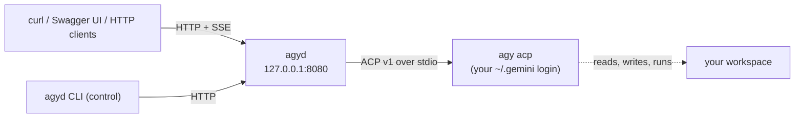
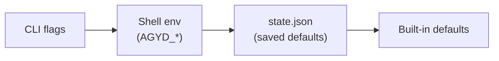

# agyd

**A lightweight local HTTP and Server-Sent Events (SSE) server for the Antigravity CLI (`agy`), with interactive Swagger UI and a companion control-plane CLI.** Run `agyd` to expose a REST and streaming API over `agy acp` (Agent Client Protocol v1 over stdio) with interactive documentation at `http://127.0.0.1:8080/docs`. It reuses your existing host `~/.gemini` login without requiring Docker, API tokens, or credential copying.



## Install

`agyd` runs on macOS (`darwin`) and Linux across `arm64` and `amd64` architectures. Before installing, ensure you have the `agy` CLI installed on your `PATH` and already signed in (if running `agy` in your terminal succeeds, you are ready).

### Option 1: One-liner installer (recommended)

Download and install the latest verified release binary to `~/.local/bin/agyd`:

```bash
curl -fsSL https://raw.githubusercontent.com/kesokaj/agyd/main/install.sh | bash
```

To install a specific version or target a custom directory:

```bash
curl -fsSL https://raw.githubusercontent.com/kesokaj/agyd/main/install.sh | bash -s -- --version v0.2.0 --dir /usr/local/bin
```

The installer verifies SHA-256 checksums from `checksums.txt` over HTTPS before installing.

### Option 2: Go install

If you have Go 1.27 or newer installed:

```bash
go install github.com/kesokaj/agyd/cmd/agyd@latest
```

### Option 3: Build from source

Clone the repository and build the binary matching `AGENTS.md` § Setup:

```bash
git clone https://github.com/kesokaj/agyd.git && cd agyd
go build -o bin/ ./cmd/agyd
```

## Quick start

Start `agyd` in your project folder and send your first prompt over HTTP in three steps:

1. **Start `agyd` in the folder you want the agent to work in:**

   ```bash
   cd ~/code/my-project
   agyd
   ```

   The first time you start `agyd` in an interactive terminal, it presents a model picker and offers to save your choices to `state.json`. Press Enter to keep `agy`'s default model.

2. **Send your first prompt and follow up from a second terminal:**

   ```bash
   curl -fsS -X POST http://127.0.0.1:8080/v1/prompt \
     -H 'Content-Type: application/json' \
     -d '{"prompt": "Summarize this repository in two sentences."}' | jq -r .text

   # Follow up in the same active conversation (it remembers)
   curl -fsS -X POST http://127.0.0.1:8080/v1/prompt \
     -H 'Content-Type: application/json' \
     -d '{"prompt": "Now list its top-level directories."}' | jq -r .text
   ```

3. **Explore interactive Swagger UI in your browser:**

   Open **http://127.0.0.1:8080/docs** to test every endpoint with interactive request builders and live responses.

> [!IMPORTANT]
> The agent works in the folder you start `agyd` from, unless you set `-workspace` or start a conversation elsewhere (`agyd new` uses the folder you run it from). `agyd` runs one `agy acp` process per active workspace folder (started on the first conversation there and stopped when its last live conversation closes), keeping each folder's workspace roots isolated. By default it approves its own tool calls (file writes, shell commands). See [Safety](#safety).

## Examples

Practical, copy-pasteable patterns for interacting with `agyd` over HTTP, streaming SSE, and the control-plane CLI.

### 1. Buffered JSON prompt & inspecting response fields

Send a prompt and inspect the full response envelope using `jq`:

```bash
curl -fsS -X POST http://127.0.0.1:8080/v1/prompt \
  -H 'Content-Type: application/json' \
  -d '{"prompt": "Explain what this repo does."}' | jq '{
    stopReason: .stopReason,
    totalTokens: .usage.totalTokens,
    text: .text,
    updateCount: (.updates | length)
  }'
```

The response contains `.text` (verbatim concatenated agent output), `.stopReason`, `.usage`, and `.updates` (verbatim ACP v1 `session/update` events in arrival order, always serialized as an array).

### 2. Live SSE streaming

Pass `Accept: text/event-stream` to receive real-time updates as the agent reasons and executes tool calls:

```bash
curl -N -sS -X POST http://127.0.0.1:8080/v1/prompt \
  -H 'Accept: text/event-stream' \
  -H 'Content-Type: application/json' \
  -d '{"prompt": "Run tests and summarize results."}'
```

Streaming SSE emits three event types:

| Event | When | `data` payload |
|---|---|---|
| `session_update` | Every ACP update in arrival order | Verbatim ACP v1 `session/update` object (thoughts, tool calls, text chunks) |
| `prompt_done` | Turn completed successfully | Metadata, usage, and concatenated `.text` (omits `.updates`) |
| `prompt_error` | Turn failed | AIP-193 error object (`code`, `status`, `message`, `details`) |

To filter live message text chunks in bash:

```bash
curl -N -sS -X POST http://127.0.0.1:8080/v1/prompt \
  -H 'Accept: text/event-stream' \
  -H 'Content-Type: application/json' \
  -d '{"prompt": "Explain the project layout."}' \
  | grep '^data: ' | sed 's/^data: //' \
  | jq -r 'select(.update.sessionUpdate == "agent_message_chunk") | .update.content.text // empty'
```

### 3. Multi-folder & isolated scripts

The current conversation is shared by interactive callers. Automated scripts that must run isolated create a dedicated conversation with `"use": false`, prompt it by ID, and delete it when finished:

```bash
# Create an isolated conversation without switching the active one
CONV_ID=$(curl -fsS -X POST http://127.0.0.1:8080/v1/conversations \
  -H 'Content-Type: application/json' \
  -d '{"cwd": "/Users/me/code/backend", "model": "gemini-4-carbon", "use": false}' \
  | jq -r .conversationId)

# Send a prompt to the specific conversation
curl -fsS -X POST "http://127.0.0.1:8080/v1/conversations/${CONV_ID}/prompt" \
  -H 'Content-Type: application/json' \
  -d '{"prompt": "Check code status."}' | jq -r .text

# Clean up when finished
curl -fsS -X DELETE "http://127.0.0.1:8080/v1/conversations/${CONV_ID}"
```

Each conversation handles one turn at a time. A second prompt or settings update while a turn is active returns `409 PROMPT_IN_FLIGHT`.

### 4. Switching models & thinking levels

Inspect available models and change settings dynamically without restarting the server:

```bash
# Check models supported by the installed agy binary
agyd models

# Switch model and thinking level on the current conversation
agyd model gemini-4-carbon --thinking high

# Alternatively via HTTP PATCH
curl -fsS -X PATCH http://127.0.0.1:8080/v1/current \
  -H 'Content-Type: application/json' \
  -d '{"model": "gemini-4-carbon", "thinkingLevel": "high"}'

# Update saved defaults for future conversations
agyd defaults --model gemini-4-carbon --thinking high
```

### 5. Context clearing, cancellation & history resume

Manage conversation lifecycles and recover context cleanly:

```bash
# Start a fresh conversation in the same directory preserving settings (old stays in history)
agyd clear
# Or via HTTP:
curl -fsS -X POST http://127.0.0.1:8080/v1/clear

# Cancel an in-flight prompt turn
curl -fsS -X POST http://127.0.0.1:8080/v1/cancel

# List recent conversations from agyd and IDE/agy CLI history
agyd list

# Resume an earlier conversation by ID
agyd use 2652ba62-a1b2-4c3d-8e4f-5061728394a5
```

### 6. Client libraries (Python & Node.js)

Call `agyd` from standard language runtimes without external dependencies:

<details>
<summary>Python example (stdlib urllib, zero dependencies)</summary>

```python
import json
import urllib.request

# 1. Buffered JSON Prompt
req = urllib.request.Request(
    "http://127.0.0.1:8080/v1/prompt",
    data=json.dumps({"prompt": "Summarize recent changes."}).encode("utf-8"),
    headers={"Content-Type": "application/json"},
    method="POST",
)
with urllib.request.urlopen(req) as resp:
    data = json.loads(resp.read().decode("utf-8"))
    print("Agent reply:", data.get("text"))

# 2. Streaming SSE Prompt
stream_req = urllib.request.Request(
    "http://127.0.0.1:8080/v1/prompt",
    data=json.dumps({"prompt": "List files."}).encode("utf-8"),
    headers={
        "Content-Type": "application/json",
        "Accept": "text/event-stream",
    },
    method="POST",
)
with urllib.request.urlopen(stream_req) as stream_resp:
    for line in stream_resp:
        line_str = line.decode("utf-8").strip()
        if line_str.startswith("data: "):
            chunk = json.loads(line_str[6:])
            update = chunk.get("update", {})
            if update.get("sessionUpdate") == "agent_message_chunk":
                print(update.get("content", {}).get("text", ""), end="", flush=True)
print()
```

</details>

<details>
<summary>Node.js example (built-in fetch, zero dependencies)</summary>

```javascript
// 1. Buffered JSON Prompt
async function runPrompt() {
  const res = await fetch("http://127.0.0.1:8080/v1/prompt", {
    method: "POST",
    headers: { "Content-Type": "application/json" },
    body: JSON.stringify({ prompt: "Summarize recent changes." }),
  });
  const data = await res.json();
  console.log("Agent reply:", data.text);
}

// 2. Streaming SSE Prompt
async function streamPrompt() {
  const res = await fetch("http://127.0.0.1:8080/v1/prompt", {
    method: "POST",
    headers: {
      "Content-Type": "application/json",
      "Accept": "text/event-stream",
    },
    body: JSON.stringify({ prompt: "List files." }),
  });

  const reader = res.body.getReader();
  const decoder = new TextDecoder();
  let buffer = "";

  while (true) {
    const { done, value } = await reader.read();
    if (done) break;
    buffer += decoder.decode(value, { stream: true });
    const lines = buffer.split("\n");
    buffer = lines.pop();

    for (const line of lines) {
      if (line.startsWith("data: ")) {
        const payload = JSON.parse(line.slice(6));
        if (payload.update?.sessionUpdate === "agent_message_chunk") {
          process.stdout.write(payload.update.content?.text || "");
        }
      }
    }
  }
  process.stdout.write("\n");
}

runPrompt().then(() => streamPrompt());
```

</details>

### 7. Scripting the CLI with `--json` and custom endpoints

The `agyd` CLI prints human-readable tables by default, but supports `--json` to output raw API responses for pipelines:

```bash
# Extract active conversation ID
CURRENT_ID=$(agyd current --json | jq -r .conversationId)

# Point CLI at a server on a custom port or remote host
agyd list --port 9090
export AGYD_URL="http://127.0.0.1:9090"
agyd current
```

### 8. LAN access and container operation

For testing across local devices or in isolated container environments:

```bash
# Listen on all interfaces with safe permissions
agyd -host 0.0.0.0 -port 8080 -permission-policy deny_all
```

When running in Docker:

- Set `AGYD_HOST=0.0.0.0` and configure `AGYD_STATE_DIR=/data/state`.
- Mount volumes for `AGYD_STATE_DIR` and host `~/.gemini` (persisting login credentials and session history).
- Pass `--init` (`docker run --init ...`) so child `agy acp` processes are properly reaped.

## HTTP API & Control-plane CLI

`agyd` exposes a strict ACP v1 wrapper alongside management endpoints for conversations, models, and defaults. The `agyd` CLI acts as a lightweight control plane backed 1:1 by `/v1/*`.

| Task | CLI | HTTP |
|---|---|---|
| Show current conversation | `agyd current` | `GET /v1/current` |
| List conversations (`*` marks current) | `agyd list` | `GET /v1/conversations` |
| Start fresh in this folder | `agyd new [--model M] [--thinking T] [--mode X]` | `POST /v1/conversations` |
| Switch conversation | `agyd use <id>` | `POST /v1/conversations/{id}/use` |
| Clear context (same folder and settings) | `agyd clear [<id>]` | `POST /v1/clear`, `POST /v1/conversations/{id}/clear` |
| Change model, thinking, or mode | `agyd model [<family>] [--thinking T] [--mode X]` | `PATCH /v1/current` |
| Inspect available models | `agyd models` | `GET /v1/models` |
| View or save defaults | `agyd defaults [--model M] [--thinking T] [--mode X]` | `GET /v1/defaults`, `PUT /v1/defaults` |

Every `/healthz` and `/v1/*` response names the active conversation via `Agyd-*` headers (`Agyd-Conversation`, `Agyd-Model`, `Agyd-Thinking-Level`, `Agyd-Mode`).

<details>
<summary>All HTTP endpoints (21 routes)</summary>

| Method | Path | Purpose |
|---|---|---|
| `GET` | `/docs` | Interactive Swagger UI documentation (`/` redirects here) |
| `GET` | `/openapi.json` | OpenAPI 3.1 specification |
| `GET` | `/healthz` | Liveness and service identity check: `200 {"service":"agyd"}` |
| `GET` | `/v1/status` | Backend readiness, agent version, permission policy, workspace |
| `GET` | `/v1/current` | Inspect current conversation (`404` if none active) |
| `PATCH` | `/v1/current` | Update settings (`model`, `thinkingLevel`, `mode`) on current conversation |
| `POST` | `/v1/prompt` | Run turn on current conversation (auto-creates if needed; buffered JSON or SSE) |
| `POST` | `/v1/cancel` | Cancel running turn on current conversation |
| `POST` | `/v1/clear` | Start fresh current conversation in same folder with current settings (`201`) |
| `POST` | `/v1/conversations` | Create conversation (`cwd`, `model`, `thinkingLevel`, `mode`, `use`) |
| `GET` | `/v1/conversations` | List live and remembered conversations (`?cwd=` filters) |
| `GET` | `/v1/conversations/{id}` | Inspect one conversation |
| `PATCH` | `/v1/conversations/{id}` | Update settings on specific conversation |
| `DELETE` | `/v1/conversations/{id}` | End conversation (`204`). Ending current clears active pointer |
| `POST` | `/v1/conversations/{id}/prompt` | Run turn on specific conversation (buffered JSON or SSE) |
| `POST` | `/v1/conversations/{id}/cancel` | Cancel running turn on specific conversation |
| `POST` | `/v1/conversations/{id}/use` | Make specific conversation current (resumes if not live) |
| `POST` | `/v1/conversations/{id}/clear` | Start fresh current conversation with `{id}` folder and settings (`201`) |
| `GET` | `/v1/models` | Available models, thinking levels, and agent modes |
| `GET` | `/v1/defaults` | Current defaults applied to new conversations |
| `PUT` | `/v1/defaults` | Persist new defaults to `state.json` |

</details>

<details>
<summary>Errors (AIP-193 format & status codes)</summary>

Errors follow the Google AIP-193 structure:

```json
{
  "error": {
    "code": 409,
    "status": "ABORTED",
    "message": "a prompt turn is in flight for this conversation",
    "details": [
      {
        "@type": "type.googleapis.com/google.rpc.ErrorInfo",
        "reason": "PROMPT_IN_FLIGHT",
        "domain": "agyd.local"
      }
    ]
  }
}
```

| HTTP | Reason | Description |
|---|---|---|
| 400 | `MALFORMED_BODY`, `INVALID_CWD`, `INVALID_SETTING` | Malformed JSON or trailing bytes; `cwd` is not an existing real directory, contains symlinks (error reports real path), or resides under `.gemini`; unsupported model/thinking/mode |
| 401 | `ACP_AUTH_REQUIRED` | `agy` is not signed in. Run `agy` once interactively |
| 403 | `FORBIDDEN_HOST`, `CROSS_ORIGIN_REQUEST` | Host header mismatch (DNS rebinding defense); cross-origin browser write |
| 404 | `NOT_FOUND`, `CONVERSATION_NOT_FOUND`, `NO_CURRENT_CONVERSATION` | Unknown route; unknown or closed conversation; no active conversation set |
| 405 | `METHOD_NOT_ALLOWED` | Wrong HTTP method; `Allow` response header indicates valid methods |
| 409 | `PROMPT_IN_FLIGHT` | A prompt turn is already running on that conversation |
| 413 | `BODY_TOO_LARGE` | Request payload exceeds 1 MiB limit |
| 502 | `ACP_RPC_ERROR`, `ACP_PROCESS_EXITED` | Underlying `agy acp` process error or unexpected termination |
| 503 | `MODELS_UNKNOWN` | Available models unknown before first conversation initialization |

</details>

## Configuration

Server configuration resolves using a strict hierarchy, where higher layers override lower layers. Command-line flags and environment variables take precedence without modifying `state.json` on disk.



<details>
<summary>Full configuration reference (12 settings & runtime details)</summary>

| Flag | Environment variable | Default | Purpose |
|---|---|---|---|
| `-model` | `AGYD_MODEL` | `agy` default | Model for new conversations (for example `gemini-4-carbon`) |
| `-thinking` | `AGYD_THINKING` | `agy` default | Thinking level: `low`, `medium`, or `high` |
| `-mode` | `AGYD_MODE` | `agy` default | Agent mode: `default`, `accept-edits`, or `plan` |
| `-no-prompt` | `AGYD_NO_PROMPT` | `false` | Skip interactive startup model picker |
| `-host` | `AGYD_HOST` | `127.0.0.1` | Listen address: IP or `localhost`. `0.0.0.0` binds all interfaces (warned) |
| `-port` | `AGYD_PORT` | `8080` (then `3000`) | Listen port (falls back to `3000` when unset and `8080` held; explicit port never falls back) |
| `-workspace` | `AGYD_WORKSPACE` | current folder | Default folder for new conversations (clean real path, no symlinks) |
| `-state-dir` | `AGYD_STATE_DIR` | `~/.config/agyd` | Directory holding `state.json` (must be absolute) |
| `-permission-policy` | `AGYD_PERMISSION_POLICY` | `allow_all` | `allow_all` or `deny_all` for ACP tool calls |
| `-log-level` | `AGYD_LOG_LEVEL` | `info` | Log level: `debug`, `info`, `warn`, or `error` (case-insensitive) |
| `-agy` | `AGYD_AGY` | `agy` | Path or name of `agy` binary |
| `-acp-args` | `AGYD_ACP_ARGS` | `acp` | Space-separated arguments forwarded to `agy` |

### Logging details & privacy guarantees

- **Structured JSON on `stdout`:** logs are emitted in JSON format with `timestamp`, `severity`, and `message`. Invalid log levels exit 1 with `"configuration error"`.
- **`INFO` level (default):** logs startup settings, `/v1/*` access logs with duration and status, metadata-only prompt turn logs (`prompt started`, `prompt finished` with duration, update count, and token totals), conversation lifecycle events, and subprocess lifecycle.
- **`DEBUG` level:** additionally emits access logs for quiet routes (`/healthz`, `/docs`, `/openapi.json`, `/static/*`) and child `acp stderr` lines (capped at 4 KiB per line, discarded at `INFO`).
- **Strict privacy rule:** prompt text, reply text, tool-call arguments, query strings, and raw ACP payload bodies are never logged at any level.

### State storage (`state.json`)

- Stored in `AGYD_STATE_DIR` (must be absolute), else `$XDG_CONFIG_HOME/agyd/`, else `~/.config/agyd/`.
- Stores `currentConversationId`, saved `defaults`, and remembered `conversations`.
- Written atomically via temporary file, sync, and rename with mode `0600` (directory `0700`).
- Read non-blocking (`O_NONBLOCK`) as a regular file capped at 4 MiB.

### CLI server discovery

The `agyd` CLI locates the server in order of: `--host`/`--port` flags > `AGYD_URL` > `AGYD_HOST`/`AGYD_PORT` > probing `GET /healthz` on `8080` then `3000`. Addresses `0.0.0.0` and `::` connect to loopback.

</details>

## Safety

`agyd` is designed for single-operator use on a trusted machine. Security is enforced through network binding, Host header checks, and CSRF protection rather than API tokens.

> [!WARNING]
> With the default `allow_all` policy, any process that reaches `agyd` can execute tool calls (write files, execute shell commands) with your user permissions. On `127.0.0.1` this is limited to local programs. When bound to `-host 0.0.0.0`, any device on your local network can trigger actions. Only bind beyond loopback on trusted networks, and prefer `-permission-policy deny_all`.

- **Loopback default:** Remote connections are rejected unless `-host` is explicitly provided.
- **Host header validation:** Requests must target `localhost`, `127.0.0.1`, `::1`, or the machine's detected network interfaces and hostnames. Other hostnames receive `403 FORBIDDEN_HOST`.
- **CSRF defense:** Cross-origin browser write requests are blocked via Go stdlib protection.
- **`deny_all` is not a full sandbox:** `deny_all` rejects only requests that `agy` forwards. If `agy`'s internal setting is configured to `always-proceed`, certain tool calls execute without asking. Every answered permission check is logged to `stdout`.

## Troubleshooting

Solutions for common configuration, authentication, and execution issues:

| Issue | Resolution |
|---|---|
| `401 ACP_AUTH_REQUIRED` | Sign in to `agy`: run `agy` once interactively in your terminal, then retry |
| CLI cannot connect to server | Start `agyd` first, or specify connection with `--port`, `AGYD_PORT`, or `AGYD_URL` |
| `GET /v1/status` returns `500` or `502` | `agy` failed to start. Verify `agy` is on `PATH` or pass `-agy /path/to/agy` |
| `400 INVALID_SETTING` | Use a model, thinking level, or mode listed in `agyd models` |
| `400 INVALID_CWD` | Provide an existing absolute path without symlinks, and not inside `~/.gemini` |
| `403 FORBIDDEN_HOST` | Send a valid Host header (`localhost`, `127.0.0.1`, or host IP with `-host`) |
| `404` on `/v1/sessions/...` | Endpoint renamed to `/v1/conversations/...` (ADR-005) |
| `409 PROMPT_IN_FLIGHT` | Wait for turn completion or send `POST /v1/cancel` |
| Startup prompts for model every time | Answer `y` to "Save as default", or set `-model` / `AGYD_MODEL` |
| Default port in use (`8080` and `3000`) | Start on another port with `agyd -port 9090` and target `--port 9090` |

## Development

Build the binary and execute the deterministic test suite:

```bash
# Build binary
go build -o bin/ ./cmd/agyd

# Run code vet and race detector tests
go vet ./... && go test -race ./...

# Verify release installer script
shellcheck install.sh
```

Architecture and technical design details are documented in [SDD.md](SDD.md) and [TDD.md](TDD.md).

## License

This project is licensed under the [MIT License](LICENSE) (Copyright (c) 2026 kesokaj).

The vendored Swagger UI distribution (`internal/web/static/swagger-ui/`) is licensed under the Apache License 2.0; see its bundled [LICENSE](internal/web/static/swagger-ui/LICENSE) and [NOTICE](internal/web/static/swagger-ui/NOTICE).
