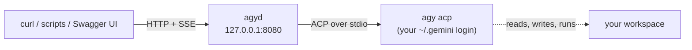
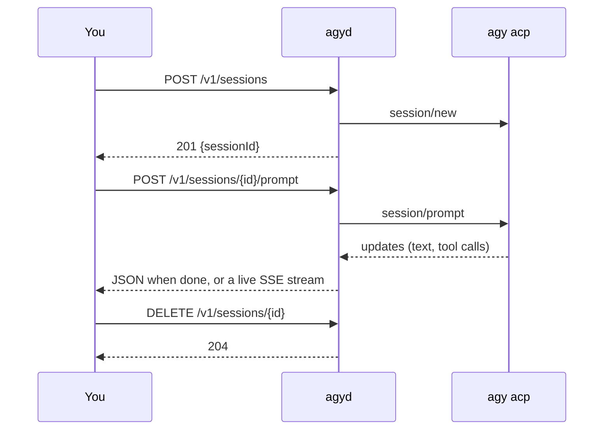

# agyd

**An HTTP API in front of the `agy` CLI you already have installed.** Run one binary and you get a REST + Server-Sent Events (SSE) API and Swagger docs at `http://127.0.0.1:8080/docs`. It reuses your existing `agy` login: no Docker, no API keys, no extra setup.



## Quick start

You need **Go 1.27+** and a working **`agy`** on your `PATH`, already signed in. If `agy` runs interactively in your terminal, you're set.

```bash
gh repo clone kesokaj/agyd && cd agyd
go install ./cmd/agyd        # installs to $(go env GOPATH)/bin
cd ~/code/my-project         # the folder the agent should work in
agyd
```

Then open **http://127.0.0.1:8080/docs**. Under any endpoint, click **Try it out** to call the API from the browser.

> [!IMPORTANT]
> The agent works in the folder you start `agyd` from, unless you set `-workspace` or pass `cwd` when you create a session. By default it approves its own tool calls (file writes, shell commands). See [Safety](#safety).

## How a conversation works

A **session** is one conversation with the agent in one folder. You create it once, then send prompts to it one turn at a time.



### 1. Create a session

```bash
SESSION_ID=$(curl -fsS -X POST http://127.0.0.1:8080/v1/sessions \
  -H 'Content-Type: application/json' -d '{}' | jq -r .sessionId)
```

The empty body `{}` uses the default workspace. To work somewhere else, send an absolute path: `{"cwd": "/Users/me/code/other"}`.

### 2. Send a prompt and wait for the answer

```bash
curl -fsS -X POST "http://127.0.0.1:8080/v1/sessions/$SESSION_ID/prompt" \
  -H 'Content-Type: application/json' \
  -d '{"prompt": "Summarize this repository in two sentences."}' | jq -r .text
```

The response is one JSON object: `text` (the agent's full reply), `stopReason`, and the raw `updates`.

### 3. Or stream the answer live

Add `Accept: text/event-stream` and the same call streams events while the agent works:

```bash
curl -N -sS -X POST "http://127.0.0.1:8080/v1/sessions/$SESSION_ID/prompt" \
  -H 'Accept: text/event-stream' -H 'Content-Type: application/json' \
  -d '{"prompt": "List the top-level directories."}'
```

| Event | When | `data` |
|---|---|---|
| `session_update` | Every chunk: text, thoughts, tool calls | The raw ACP update |
| `prompt_done` | The turn finished | Same shape as the JSON response |
| `prompt_error` | The turn failed | An error object |

### 4. Keep talking, cancel, or clean up

- **Follow-up:** send another prompt to the same `SESSION_ID`. The agent remembers the conversation.
- **Stop a long turn:** `curl -X POST .../v1/sessions/$SESSION_ID/cancel`
- **End the session:** `curl -X DELETE .../v1/sessions/$SESSION_ID`

A session takes **one turn at a time**. A second prompt sent while one is running gets `409 PROMPT_IN_FLIGHT`.

## Endpoints

| Method | Path | What it does |
|---|---|---|
| `GET` | `/docs` | Swagger UI (`/` redirects here) |
| `GET` | `/openapi.json` | OpenAPI 3.1 spec, for client generators |
| `GET` | `/healthz` | Liveness: `204` |
| `GET` | `/v1/status` | Agent readiness, version, policy, active session count |
| `POST` | `/v1/sessions` | Create a session (`cwd` optional) |
| `GET` | `/v1/sessions` | List sessions |
| `GET` | `/v1/sessions/{id}` | One session |
| `POST` | `/v1/sessions/{id}/prompt` | Run a turn: JSON, or SSE with `Accept: text/event-stream` |
| `POST` | `/v1/sessions/{id}/cancel` | Cancel the running turn |
| `DELETE` | `/v1/sessions/{id}` | End a session: `204` |

<details>
<summary>Errors</summary>

Every error has the same shape (Google AIP-193):

```json
{"error": {"code": 409, "status": "ABORTED", "message": "a prompt turn is already in flight for this session", "details": [{"@type": "type.googleapis.com/google.rpc.ErrorInfo", "reason": "PROMPT_IN_FLIGHT", "domain": "agyd.local"}]}}
```

| HTTP | Reason | Meaning |
|---|---|---|
| 400 | `MALFORMED_BODY`, `INVALID_CWD` | Bad JSON, or `cwd` is not a clean absolute path (or is inside `.gemini`) |
| 401 | `ACP_AUTH_REQUIRED` | `agy` is not signed in. Run `agy` once, or `agy acp --login` |
| 403 | `FORBIDDEN_HOST` | The request's `Host` header is not loopback |
| 404 | `SESSION_NOT_FOUND` | Unknown or deleted session |
| 409 | `PROMPT_IN_FLIGHT` | That session is already running a turn |
| 502 | `ACP_RPC_ERROR`, `ACP_PROCESS_EXITED` | `agy` returned an error or exited. It restarts on the next call |

</details>

## Configuration

Every setting works as a flag or an environment variable. The defaults suit a typical laptop.

| Flag | Env var | Default | What it does |
|---|---|---|---|
| `-addr` | `AGYD_ADDR` | `127.0.0.1:8080` | Listen address. Must be loopback and include a port |
| `-workspace` | `AGYD_WORKSPACE` | current folder | Default `cwd` for new sessions |
| `-permission-policy` | `AGYD_PERMISSION_POLICY` | `allow_all` | `allow_all` or `deny_all` for agent tool calls |
| `-agy` | `AGYD_AGY` | `agy` | Path to the `agy` binary |
| `-acp-args` | `AGYD_ACP_ARGS` | `acp` | Arguments passed to `agy` |

```bash
agyd -addr 127.0.0.1:9090 -workspace ~/code/sandbox -permission-policy deny_all
```

## Safety

`agyd` is built for **one person on their own machine**.

> [!WARNING]
> With the default `allow_all`, anything that can reach `127.0.0.1:8080` can make the agent write files and run shell commands **as you**. That includes other local programs. Use `-permission-policy deny_all` when you only need read-only answers, and point `-workspace` at a folder you're willing to let the agent change.

- **Loopback only.** `agyd` refuses to start on `0.0.0.0` or any non-loopback address.
- **Host check.** It rejects requests whose `Host` header isn't loopback (`403`). This blocks DNS-rebinding attacks.
- **CSRF protection.** Browser requests from other websites are blocked.
- **No token.** There is no API key. The protection is the loopback binding plus the two checks above.

## Troubleshooting

| Symptom | Fix |
|---|---|
| `401 ACP_AUTH_REQUIRED` | Sign in: run `agy` once in a terminal, then retry |
| `GET /v1/status` returns `500` or `502` | `agy` failed to start. Check it is on `PATH`, or pass `-agy /full/path/to/agy`, and read `agyd`'s log |
| `400 INVALID_CWD` | Use an absolute path that exists, e.g. `"$(pwd)"`, and that is not under `~/.gemini` |
| `403 FORBIDDEN_HOST` | Call `127.0.0.1` or `localhost`, not your LAN IP or hostname |
| `409 PROMPT_IN_FLIGHT` | Wait for the turn to finish, or `POST .../cancel` first |
| Port already in use | `agyd -addr 127.0.0.1:9090` |

## Development

```bash
go build ./cmd/agyd                 # build
go vet ./... && go test -race ./... # test (no real agy needed)
```

Design docs: [SDD.md](SDD.md) (architecture) and [TDD.md](TDD.md) (components and tests). Decisions, specs and the testing guide live in the project trail: `fyr record list --kind adr`, `fyr record get GUIDE-testing`.
