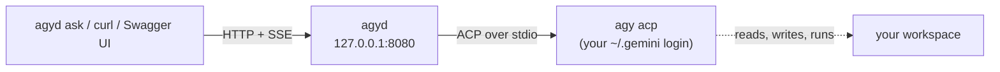
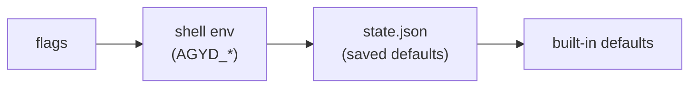

# agyd

**An HTTP API and a terminal client in front of the `agy` CLI you already have installed.** Run `agyd` and you get a REST + Server-Sent Events (SSE) API, Swagger docs at `http://127.0.0.1:8080/docs`, and `agyd ask` in any other terminal. It reuses your existing `agy` login: no Docker, no API keys, no extra setup.



## Quick start

You need **Go 1.27+** and a working **`agy`** on your `PATH`, already signed in. If `agy` runs interactively in your terminal, you're set.

```bash
gh repo clone kesokaj/agyd && cd agyd
go build -o bin/ ./cmd/agyd    # writes bin/agyd
export PATH="$PWD/bin:$PATH"   # or copy bin/agyd to a folder on your PATH
cd ~/code/my-project           # the folder the agent should work in
agyd
```

The first time, `agyd` asks which model and thinking level to use and offers to save them as your default. Press Enter to accept agy's default. Then, in a **second terminal**:

```bash
agyd ask "Summarize this repository in two sentences."
agyd ask "Now list its top-level directories."    # same conversation: it remembers
```

Every command prints which conversation, model and thinking level it used, on stderr:

```text
agyd: conversation=2652ba62-... model=gemini-4-carbon thinking=high mode=default
```

Prefer a browser? Open **http://127.0.0.1:8080/docs** and click **Try it out** under any endpoint.

> [!IMPORTANT]
> The agent works in the folder you start `agyd` from, unless you set `-workspace` or start a conversation elsewhere (`agyd new` uses the folder you run it from). By default it approves its own tool calls (file writes, shell commands). See [Safety](#safety).

## Conversations

agyd always has a **current conversation**. `agyd ask` and `POST /v1/prompt` talk to it, so you can prompt right away. When you restart `agyd`, it picks the current conversation up again.

| You want to | CLI | HTTP |
|---|---|---|
| Ask something | `agyd ask "..."` | `POST /v1/prompt` |
| Start fresh in this folder | `agyd new [--model M] [--thinking T]` | `POST /v1/conversations` |
| See all conversations | `agyd list` (`*` marks current) | `GET /v1/conversations` |
| Switch to another one | `agyd use <id>` | `POST /v1/conversations/{id}/use` |
| See the current one | `agyd current` | `GET /v1/current` |
| Change model or thinking now | `agyd model <family> [--thinking T]` | `PATCH /v1/current` |
| See what agy offers | `agyd models` | `GET /v1/models` |
| Change the saved default | `agyd defaults --model M --thinking T` | `PUT /v1/defaults` |

`agyd list` shows every agy conversation on this machine, including ones from the IDE or the `agy` CLI; `agyd use` resumes any of them. Every command takes `--json` to print the raw API response, and `agyd help` lists them all.

```bash
agyd new --model claude-sonnet-5-5 --thinking low
agyd ask "Which model are you?"
agyd model gemini-4-carbon --thinking high     # same conversation, new model
echo "Explain main.go" | agyd ask              # prompt from stdin
```

Press **Ctrl-C** during `agyd ask` to stop the turn.

## HTTP API

The CLI is a thin client of this API, so anything it does works with `curl` too.

### Ask, and wait for the answer

```bash
curl -fsS -X POST http://127.0.0.1:8080/v1/prompt \
  -H 'Content-Type: application/json' \
  -d '{"prompt": "Summarize this repository in two sentences."}' | jq -r .text
```

The response is one JSON object: `conversationId`, `model`, `thinkingLevel`, `mode`, `text` (the agent's full reply), `stopReason`, and the raw `updates`. If there is no current conversation yet, agyd creates one.

### Or stream the answer live

Add `Accept: text/event-stream` and the same call streams events while the agent works:

```bash
curl -N -sS -X POST http://127.0.0.1:8080/v1/prompt \
  -H 'Accept: text/event-stream' -H 'Content-Type: application/json' \
  -d '{"prompt": "List the top-level directories."}'
```

| Event | When | `data` |
|---|---|---|
| `session_update` | Every chunk: text, thoughts, tool calls | The raw ACP update |
| `prompt_done` | The turn finished | Same shape as the JSON response |
| `prompt_error` | The turn failed | An error object |

### Which conversation answered

Every `/healthz` and `/v1/*` response names the current conversation in headers (omitted when there is none):

```text
Agyd-Conversation: 2652ba62-...
Agyd-Model: gemini-4-carbon
Agyd-Thinking-Level: high
Agyd-Mode: default
```

### Scripts that want a fixed conversation

The current conversation is shared by every client. A script that must not be affected by `agyd use` elsewhere creates its own and addresses it by ID:

```bash
ID=$(curl -fsS -X POST http://127.0.0.1:8080/v1/conversations \
  -H 'Content-Type: application/json' \
  -d '{"cwd": "/Users/me/code/other", "model": "gemini-4-carbon", "use": false}' | jq -r .conversationId)
curl -fsS -X POST "http://127.0.0.1:8080/v1/conversations/$ID/prompt" \
  -H 'Content-Type: application/json' -d '{"prompt": "hi"}' | jq -r .text
curl -X DELETE "http://127.0.0.1:8080/v1/conversations/$ID"
```

`"use": false` keeps the current conversation as it is. A conversation takes **one turn at a time**: a second prompt, or a model change, sent while a turn runs gets `409 PROMPT_IN_FLIGHT`.

### Endpoints

| Method | Path | What it does |
|---|---|---|
| `GET` | `/docs` | Swagger UI (`/` redirects here) |
| `GET` | `/openapi.json` | OpenAPI 3.1 spec, for client generators |
| `GET` | `/healthz` | Liveness and service identity: `200` `{"service":"agyd"}` |
| `GET` | `/v1/status` | Agent readiness, version, policy, workspace |
| `GET` | `/v1/current` | The current conversation (`404` if none) |
| `PATCH` | `/v1/current` | Change its `model`, `thinkingLevel` or `mode` |
| `POST` | `/v1/prompt` | Run a turn on the current conversation (creates one if needed): JSON, or SSE with `Accept: text/event-stream` |
| `POST` | `/v1/cancel` | Cancel the current conversation's running turn |
| `POST` | `/v1/conversations` | Create one (`cwd`, `model`, `thinkingLevel`, `mode`, `use`; all optional). Becomes current unless `"use": false` |
| `GET` | `/v1/conversations` | List live conversations and agy's history, newest first (`?cwd=` filters) |
| `GET` | `/v1/conversations/{id}` | One conversation |
| `PATCH` | `/v1/conversations/{id}` | Change its settings |
| `DELETE` | `/v1/conversations/{id}` | End it: `204`. Ending the current one clears the pointer |
| `POST` | `/v1/conversations/{id}/prompt` | Run a turn on that conversation |
| `POST` | `/v1/conversations/{id}/cancel` | Cancel its running turn |
| `POST` | `/v1/conversations/{id}/use` | Make it current (resumes it if it is not live) |
| `GET` | `/v1/models` | Models, thinking levels and modes agy offers |
| `GET` | `/v1/defaults` | Defaults for new conversations |
| `PUT` | `/v1/defaults` | Change the defaults and save them to `state.json` |

> [!NOTE]
> Before ADR-005 these paths were `/v1/sessions/...` with a `sessionId` field. They are now `/v1/conversations/...` and `conversationId`; the old paths return `404`.

<details>
<summary>Errors</summary>

Every error has the same shape (Google AIP-193):

```json
{"error": {"code": 409, "status": "ABORTED", "message": "a prompt turn is in flight for this conversation", "details": [{"@type": "type.googleapis.com/google.rpc.ErrorInfo", "reason": "PROMPT_IN_FLIGHT", "domain": "agyd.local"}]}}
```

| HTTP | Reason | Meaning |
|---|---|---|
| 400 | `MALFORMED_BODY`, `INVALID_CWD`, `INVALID_SETTING` | Bad JSON or data after the JSON value; `cwd` is not a clean absolute path of an existing real directory, contains a symlink (the error names the real path), or is inside `.gemini` (in any letter case); a model, thinking level or mode agy does not offer |
| 401 | `ACP_AUTH_REQUIRED` | `agy` is not signed in. Run `agy` once, or `agy acp --login` |
| 403 | `FORBIDDEN_HOST`, `CROSS_ORIGIN_REQUEST` | The request's `Host` header is not an address agyd accepts (loopback, or with `-host` this machine's IPs and hostname); a browser sent a cross-origin write |
| 404 | `NOT_FOUND`, `CONVERSATION_NOT_FOUND`, `NO_CURRENT_CONVERSATION` | Unknown path; unknown or ended conversation; or nothing is current yet |
| 405 | `METHOD_NOT_ALLOWED` | Known `/healthz` or `/v1` path, wrong method. The `Allow` header lists the right ones |
| 409 | `PROMPT_IN_FLIGHT` | That conversation is running a turn |
| 413 | `BODY_TOO_LARGE` | The request body is over 1 MiB |
| 502 | `ACP_RPC_ERROR`, `ACP_PROCESS_EXITED` | `agy` returned an error or exited. It restarts on the next call |
| 503 | `MODELS_UNKNOWN` | agyd has not seen agy's model list yet (no conversation started) |

</details>

## Configuration

Each setting comes from flags, environment variables, saved defaults in `state.json`, or built-in defaults. Highest wins:



| Flag | Env var | Default | What it does |
|---|---|---|---|
| `-model` | `AGYD_MODEL` | agy's default | Model for new conversations, e.g. `gemini-4-carbon` (`agyd models` lists them) |
| `-thinking` | `AGYD_THINKING` | agy's default | Thinking level: `low`, `medium` or `high` |
| `-mode` | `AGYD_MODE` | agy's default | Agent mode: `default`, `accept-edits` or `plan` |
| `-no-prompt` | `AGYD_NO_PROMPT` | `false` | Never ask for the model at startup |
| `-host` | `AGYD_HOST` | `127.0.0.1` | Listen address: an IP or `localhost`. `0.0.0.0` listens on all IPv4 interfaces, `::` on all IPv6 ones (see [Safety](#safety)) |
| `-port` | `AGYD_PORT` | `8080` (then `3000`) | Listen port (falls back to `3000` when unset and `8080` is taken; explicit port never falls back) |
| `-workspace` | `AGYD_WORKSPACE` | current folder | Default folder for new conversations (real path, no symlinks) |
| `-state-dir` | `AGYD_STATE_DIR` | `~/.config/agyd` | Directory holding `state.json` (must be absolute) |
| `-permission-policy` | `AGYD_PERMISSION_POLICY` | `allow_all` | `allow_all` or `deny_all` for agent tool calls |
| `-agy` | `AGYD_AGY` | `agy` | Path to the `agy` binary |
| `-acp-args` | `AGYD_ACP_ARGS` | `acp` | Arguments passed to `agy` |

- **`state.json`** lives in `AGYD_STATE_DIR` (must be an absolute path when set), else `$XDG_CONFIG_HOME/agyd/` (when absolute), else `~/.config/agyd/`. It is flat (no longer keyed by port), holding `currentConversationId`, `defaults` (`model`, `thinkingLevel`, `mode`), and `conversations` (remembered folders and settings). It is written atomically via temp file + sync + rename with mode `0600` (directory `0700`) and read non-blocking (`O_NONBLOCK`) as a regular file capped at 4 MiB.
- **Saved defaults** in `state.json` are written by the startup question, `agyd defaults --model ...`, and `PUT /v1/defaults`. Startup flags or env vars override saved defaults for the running process without overwriting `state.json` on disk.
- **The startup question** appears only in an interactive terminal when no flag, env var, or saved default sets a model. `-no-prompt`, or starting without a terminal, skips the question and uses agy's default.
- **The CLI** finds the server through `--host`/`--port`, then `AGYD_URL`, then `AGYD_HOST`/`AGYD_PORT` in your shell; otherwise it probes `GET /healthz` on `8080` then `3000`, accepting only `200` JSON `{"service":"agyd"}` (neither `config.env` nor `./.env` are read). `0.0.0.0` and `::` dial loopback.

```bash
agyd -port 9090 -workspace ~/code/sandbox -permission-policy deny_all
agyd ask --port 9090 "hello"
```

### Reaching agyd from another device

```bash
agyd -host 0.0.0.0 -port 8080
```

Then open `http://<your-machine-ip>:8080/docs` from the other device, or run `agyd ask --host <your-machine-ip> "..."` there. At startup agyd logs a warning listing the addresses it accepts: your machine's IPs and its hostname. macOS may ask whether to allow incoming connections.

### Running in a container

To run `agyd` inside a container:

- **Configure via `AGYD_*` env vars:** set `AGYD_HOST=0.0.0.0` to accept external traffic, configure `AGYD_STATE_DIR=/data/state`, and provide any model or mode flags. Non-TTY stdin automatically skips the startup picker. Logs stream as structured JSON on stdout, and `SIGTERM` stops the server cleanly with state already synced to disk.
- **Persist two directories:** mount host volumes or named volumes for `AGYD_STATE_DIR` (or `~/.config/agyd`, storing `state.json`) and `~/.gemini` (where `agy` stores login credentials and history).
- **Pass `--init`:** run containers with `docker run --init ...` (or equivalent init process like tini) so `agy` child processes are properly reaped when `agyd` runs as PID 1.

## Safety

`agyd` is built for **one person on their own machine**.

> [!WARNING]
> With the default `allow_all`, anything that can reach agyd can make the agent write files and run shell commands **as you**. On the default `127.0.0.1` that means local programs. With `-host 0.0.0.0` it means **anyone on your network**, because there is no API key. Only listen beyond loopback on a network you trust, and prefer `-permission-policy deny_all` when you do.

- **Loopback by default.** Remote access only happens when you pass `-host`.
- **Host check.** Requests must name `localhost`, `127.0.0.1` or `::1`, or (with `-host`) one of your machine's own IPs or its hostname. Anything else gets `403`. This blocks DNS-rebinding attacks.
- **CSRF protection.** Browser requests from other websites are blocked.
- **No token.** There is no API key. The protection is the bind address plus the two checks above. Anyone who passes them can also list your agy conversations (titles included), switch the current one, and change your saved defaults in `state.json`.
- **`deny_all` is not a sandbox.** It answers only the permission requests agy sends, and agy decides whether to send them from its own settings (`toolPermission` in `~/.gemini/antigravity-cli/settings.json`). With `always-proceed`, live checks (agy 1.5.11) saw reads, edits, shell commands and writes outside the workspace run with no request at all; `accept-edits` writes without asking by design. Every request agyd does answer is logged as a `permission decision` line. Run agyd in a folder you are willing to have changed.

## Troubleshooting

| Symptom | Fix |
|---|---|
| `401 ACP_AUTH_REQUIRED` | Sign in: run `agy` once in a terminal, then retry |
| `agyd ask` says it cannot connect | Start `agyd` first, or point the CLI at it with `--port`, `AGYD_PORT` or `AGYD_URL` |
| `GET /v1/status` returns `500` or `502` | `agy` failed to start. Check it is on `PATH`, or pass `-agy /full/path/to/agy`, and read `agyd`'s log |
| `400 INVALID_SETTING` | Use a value from `agyd models` |
| `400 INVALID_CWD` | Use a real absolute path without symlinks, e.g. `"$(pwd -P)"` (or the real path named in the error), and not under `~/.gemini` |
| `403 FORBIDDEN_HOST` | Use an address agyd accepts: `127.0.0.1`/`localhost`, or with `-host 0.0.0.0` one listed in its startup warning |
| `404` on `/v1/sessions/...` | Renamed to `/v1/conversations/...` (ADR-005) |
| `409 PROMPT_IN_FLIGHT` | Wait for the turn to finish, or cancel it first (`POST /v1/cancel`, or Ctrl-C in `agyd ask`) |
| Startup asks for a model every time | Answer `y` to "Save as default", or set `-model`/`AGYD_MODEL` |
| Port already in use (`8080` and `3000`, or explicit `-port`) | `agyd -port 9090`, then `agyd ask --port 9090 ...` (or `export AGYD_PORT=9090`) |

## Development

```bash
go build -o bin/ ./cmd/agyd         # build to bin/agyd (gitignored)
go vet ./... && go test -race ./... # test (no real agy needed)
```

Layout: `cmd/agyd/` is the program's source (server entry point and CLI client), `internal/` the packages it uses, `bin/` the build output.

Design docs: [SDD.md](SDD.md) (architecture) and [TDD.md](TDD.md) (components and tests). Decisions, specs and the testing guide live in the project trail: `fyr record list --kind adr`, `fyr record get GUIDE-testing`.
