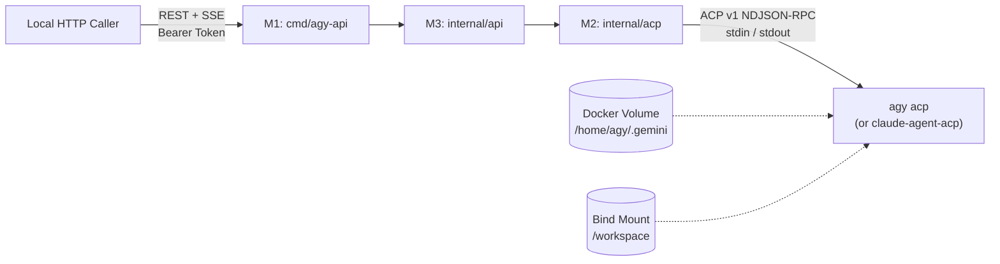
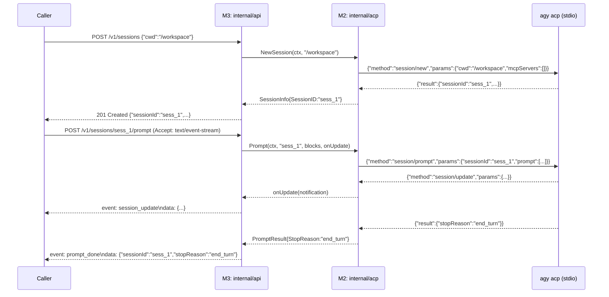

# SDD — agy-api

A single-binary Go HTTP/SSE gateway (`cmd/agy-api`) translates authenticated REST calls into Agent Client Protocol (ACP v1) JSON-RPC 2.0 messages over stdio to a warm `agy acp` subprocess inside a Docker container.
Status: draft · Last updated: 2026-11-16 · Requirements: [PRD.md](PRD.md) · Technical design: [TDD.md](TDD.md)

## Context

`agy-api` sits between local HTTP callers on `127.0.0.1:8080` and the `agy acp` child process, mounting a named Docker volume at `/home/agy/.gemini` for one-time OAuth credentials and `/workspace` for agent file operations.

## Components

Every package has one responsibility in the HTTP-to-ACP pipeline.

| ID | Component | Responsibility | Satisfies |
|---|---|---|---|
| M1 | `cmd/agy-api` | Binary entry point, flag/env parsing, `log/slog` setup, and graceful `SIGTERM` shutdown | — |
| M2 | `internal/acp` | ACP v1 JSON-RPC 2.0 stdio transport, handshake, session lifecycle, `session/update` fan-out, and `session/request_permission` policy | — |
| M3 | `internal/api` | `net/http` mux, bearer token authentication middleware, AIP-193 JSON error formatting, and SSE prompt streaming | — |

## Flows

### Prompt Turn over SSE

A caller creates a session via `POST /v1/sessions` and streams a prompt turn via `POST /v1/sessions/{id}/prompt` (`Accept: text/event-stream`).

## Decisions

Architectural choices link to their ADR records (`fyr record get ADR-NNN`).

- Use `agy acp` (ACP v1 over stdio) rather than headless `agy -p --input-format stream-json` so one warm process handles multi-turn sessions and the backend binary can be swapped for `claude-agent-acp` — rejected: `agy -p` per-turn subprocess wrapper — `ADR-001`.

## Cross-cutting

Security, privacy, observability, and cost policies apply across all three components.

- **Security:** Static bearer token (`AGY_API_TOKEN`) verified with `crypto/subtle.ConstantTimeCompare` on every `/v1/*` route; container runs as non-root `agy` (`UID 1000`), binds to host loopback `127.0.0.1:8080`, and stores credentials in a named volume (`agy-gemini-data`), never in image layers.
- **Privacy:** Request bodies, prompts, and bearer tokens are never logged.
- **Observability:** Structured JSON logs on `stdout` via `log/slog` (`severity`, `message`, `timestamp`); `GET /healthz` and `GET /v1/status` report gateway and ACP child readiness.
- **Cost:** Local container runtime only; zero cloud infrastructure cost.

## Deployment

Runs locally in Docker via Colima (`docker compose up -d`) or directly on the host (`go run ./cmd/agy-api`); see `DEPLOY-local` (`fyr record get DEPLOY-local`).

## Risks

Key technical risks and the checks that detect them early:

- `agy acp` child process crashes or exits mid-turn — detected by the stdio reader loop closing pending RPC calls with a structured error and `internal/acp` automatically restarting or surfacing unhealthy status on `/v1/status`.
- OAuth session expires inside the named volume — detected by `session/prompt` returning an ACP authentication error mapped to HTTP `401`/`502`, remediated by re-running `docker compose run --rm agy-api agy acp --login`.

## Trace

Requirement-to-component mapping stays `—` until `PRD.md` requirements are approved via `/fyr-requirements`.

| Requirement | Components |
|---|---|
| — | M1, M2, M3 |
