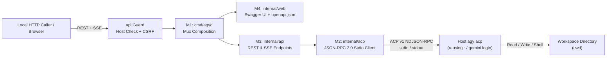
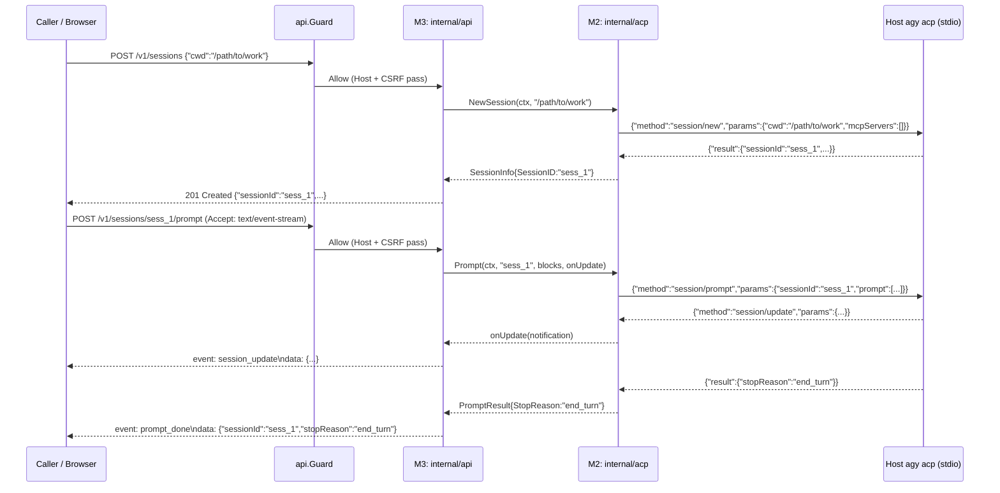

# SDD — agy-api

A single-binary Go HTTP/SSE gateway (`cmd/agyd`) translates REST calls into Agent Client Protocol (ACP v1) JSON-RPC 2.0 messages over stdio to a warm `agy acp` subprocess on the host and serves embedded Swagger UI documentation.
Status: agreed · Last updated: 2026-11-16 · Requirements: [PRD.md](PRD.md) · Technical design: [TDD.md](TDD.md)

## Context

`agyd` runs directly on the operator's machine, listening on `127.0.0.1:8080`. It supervises the host's installed `agy` CLI in `acp` mode, inheriting the operator's existing `~/.gemini` login without credentials in transit or containers.

## Components

Every package has one responsibility in the HTTP-to-ACP and documentation pipeline.

| ID | Component | Responsibility | Satisfies |
|---|---|---|---|
| M1 | `cmd/agyd` | Binary entry point, flag/env parsing (`-host`/`-port`, loopback default), Host allowlist for a non-loopback bind, mux composition (`internal/web` + `internal/api` wrapped in `api.Guard`), `log/slog` setup, and graceful `SIGINT`/`SIGTERM` shutdown | — |
| M2 | `internal/acp` | ACP v1 JSON-RPC 2.0 stdio transport, handshake, session lifecycle, `session/update` fan-out, and `session/request_permission` policy | — |
| M3 | `internal/api` | REST and SSE HTTP handlers, route table (`api.Routes`), Host header validation and `http.CrossOriginProtection` (`api.Guard`), and AIP-193 JSON error formatting | — |
| M4 | `internal/web` | Embedded OpenAPI 3.1 specification (`openapi.json`), vendored Swagger UI assets (`docs.html`, `docs.js`), root redirect (`GET /{$}` -> `/docs`), and CSP/nosniff security headers | — |

## Route table

All HTTP routes are exposed through the outer mux wrapped in `api.Guard`:

| Method & Path | Package | Purpose |
|---|---|---|
| `GET /{$}` | `internal/web` | 302 redirect to `/docs` |
| `GET /docs` | `internal/web` | Vendored Swagger UI page (`docs.html`) |
| `GET /openapi.json` | `internal/web` | Hand-written OpenAPI 3.1 specification |
| `GET /static/*` | `internal/web` | Embedded static Swagger UI assets |
| `GET /healthz` | `internal/api` | Liveness check returning `204 No Content` |
| `GET /v1/status` | `internal/api` | Gateway and ACP child readiness, backend info, permission policy, and default `workspace` |
| `POST /v1/sessions` | `internal/api` | Creates a new ACP session via `session/new` |
| `GET /v1/sessions` | `internal/api` | Lists tracked in-memory sessions |
| `GET /v1/sessions/{sessionId}` | `internal/api` | Retrieves metadata for a single session |
| `POST /v1/sessions/{sessionId}/prompt` | `internal/api` | Executes prompt turn over `session/prompt` (SSE or buffered JSON) |
| `POST /v1/sessions/{sessionId}/cancel` | `internal/api` | Sends `session/cancel` notification for active prompt |
| `DELETE /v1/sessions/{sessionId}` | `internal/api` | Closes session via `session/close` and unregisters it |

`api.Routes` is an exported slice of `Route{Method, Pattern, Handler}` registered by `internal/api`. A unit test asserts that `api.Routes` matches the path-method matrix in `internal/web/static/openapi.json`.

## Flows

### Prompt turn over SSE

A caller creates a session via `POST /v1/sessions` and streams a prompt turn via `POST /v1/sessions/{id}/prompt` (`Accept: text/event-stream`).

## Decisions

Architectural choices link to their ADR records (`fyr record get ADR-NNN`).

- Ship `agyd` as a single host binary wrapping installed `agy` CLI over stdio ACP, dropping Docker and container sandboxing in favor of loopback binding, Host header guard, and CSRF protection (`http.CrossOriginProtection`), reusing host `~/.gemini` login without in-app token or credentials — `ADR-002` (supersedes `ADR-001`'s Docker runtime).
- Default to loopback but allow `-host 0.0.0.0` as an explicit, warned opt-in, with the Host guard extended to the machine's own IPs and hostname — rejected: `0.0.0.0` by default (unauthenticated agent control for anyone on the network) — `ADR-004` (amends `ADR-002`'s loopback-only bind).
- Use `agy acp` (ACP v1 over stdio) rather than headless `agy -p --input-format stream-json` so one warm process handles multi-turn sessions and the backend binary can be swapped for `claude-agent-acp` — rejected: `agy -p` per-turn subprocess wrapper — `ADR-001`.

## Cross-cutting

Security, privacy, observability, and cost policies apply across all components.

- **Security:** Binds to loopback by default (`-host 127.0.0.1`). `-host 0.0.0.0` (or another IP) is an explicit opt-in, listening on that address family only (`tcp4`/`tcp6`, so `0.0.0.0` never also exposes IPv6), that logs a startup warning (`ADR-004`). `api.Guard` enforces Host header matching: loopback names always, plus the machine's own interface IPs and hostname when bound beyond loopback; anything else gets `403 FORBIDDEN_HOST`. Standard library `http.CrossOriginProtection` guards against CSRF. No in-app API token is used. Tool execution is auto-approved under `allow_all` default (or rejected under `deny_all`).
- **Privacy:** Request bodies, prompts, and credentials are never logged.
- **Observability:** Structured JSON logs on `stdout` via `log/slog` (`severity`, `message`, `timestamp`, `url`); `GET /healthz` and `GET /v1/status` report gateway and ACP child readiness.
- **Cost:** Local host binary only; zero cloud infrastructure cost.

## Deployment

Runs locally on the host machine (`go install ./cmd/agyd` or `go run ./cmd/agyd`); see `DEPLOY-local` (`fyr record get DEPLOY-local`).

## Risks

Key technical risks and the checks that detect them early:

- `agy` CLI not found on host `$PATH` — detected at startup via `exec.LookPath`, causing `agyd` to exit `1` with message `agy not found on PATH; install agy-cli or pass -agy /path/to/agy`.
- `agy acp` child process crashes or exits mid-turn — detected by the stdio reader loop closing pending RPC calls with a structured error, clearing in-memory session registry, and lazily restarting on next request.
- OAuth session expires in host `~/.gemini` — detected when `session/prompt` returns an ACP authentication error mapped to HTTP `401 UNAUTHENTICATED`, remediated by running `agy` interactively once on the host.

## Trace

Requirement-to-component mapping stays `—` until `PRD.md` requirements are approved via `/fyr-requirements`.

| Requirement | Components |
|---|---|
| — | M1, M2, M3, M4 |
