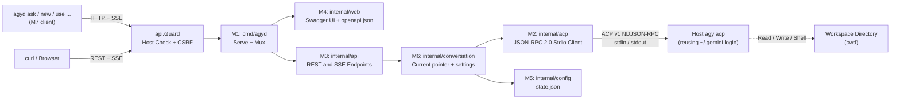
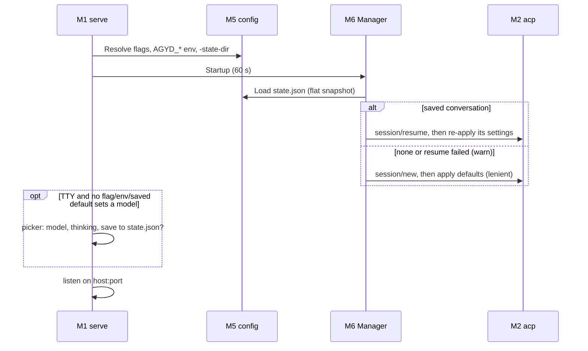
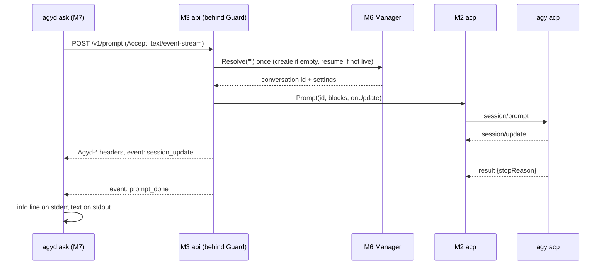

# SDD — agyd

A single Go binary (`cmd/agyd`) serves a REST/SSE API that translates calls into Agent Client Protocol (ACP v1) JSON-RPC 2.0 messages over stdio to a warm `agy acp` subprocess, keeps one current conversation with model/thinking defaults, serves embedded Swagger UI, and doubles as a terminal client (`agyd ask|new|list|use|...`) of a running server.
Status: agreed · Last updated: 2026-11-18 · Requirements: [PRD.md](PRD.md) · Technical design: [TDD.md](TDD.md)

## Context

`agyd` runs directly on the operator's machine, listening on `127.0.0.1:8080`. It supervises the host's installed `agy` CLI in `acp` mode, inheriting the operator's existing `~/.gemini` login without credentials in transit or containers. Its own state is a single `state.json` file in the state directory (`AGYD_STATE_DIR`, default `~/.config/agyd`).

## Components

Every package has one responsibility.

| ID | Component | Responsibility | Satisfies |
|---|---|---|---|
| M1 | `cmd/agyd` (serve) | Entry point and first-word dispatch (serve vs client), flag and `AGYD_*` env config with `-state-dir` support (`serveconfig.go`), Host allowlist for a non-loopback bind, startup conversation and model picker (`startup.go`, `picker.go`), mux composition wrapped in `api.Guard`, `log/slog`, graceful `SIGINT`/`SIGTERM` shutdown | — |
| M2 | `internal/acp` | ACP v1 JSON-RPC 2.0 stdio transport, handshake, session lifecycle, `session/set_config_option`, `session/list`, `session/resume`, `session/update` fan-out, `session/request_permission` policy | — |
| M3 | `internal/api` | REST and SSE handlers on the Manager, route table, `Agyd-*` response headers, Host validation and `http.CrossOriginProtection` (`api.Guard`), AIP-193 errors | — |
| M4 | `internal/web` | Embedded OpenAPI 3.1 spec (`openapi.json`), vendored Swagger UI, root redirect, CSP/nosniff headers | — |
| M5 | `internal/config` | Flat `state.json` store (`currentConversationId`, `defaults`, `conversations`), `AGYD_STATE_DIR` resolution, safe non-blocking regular file reading (capped at 4 MiB), `ValidSettingValue`, atomic 0600 writes | — |
| M6 | `internal/conversation` | `Manager`: the one owner of current pointer, defaults, per-conversation memo settings, and full `state.json` snapshots under `saveMu` (lock order: `opMu -> saveMu -> mu`); startup flag/env defaults override without clobbering disk; resolve-or-create, use/resume, list merge with agy history | — |
| M7 | `cmd/agyd` (client) | `agyd ask|new|list|use|current|model|models|defaults`: stdlib HTTP client of a running agyd, base URL from `--host`/`--port` > shell `AGYD_*` env > `127.0.0.1:8080`, stderr info line, `--json` | — |

## Route table

All HTTP routes are exposed through the outer mux wrapped in `api.Guard` (ADR-005 renamed `/v1/sessions` to `/v1/conversations`):

| Method & Path | Package | Purpose |
|---|---|---|
| `GET /{$}` | `internal/web` | 302 redirect to `/docs` |
| `GET /docs`, `GET /openapi.json`, `GET /static/*` | `internal/web` | Swagger UI, spec and assets |
| `GET /healthz` | `internal/api` | Liveness: `204` |
| `GET /v1/status` | `internal/api` | ACP child readiness, backend info, permission policy, default `workspace` |
| `GET`, `PATCH /v1/current` | `internal/api` | Current conversation; change its settings |
| `POST /v1/prompt`, `POST /v1/cancel` | `internal/api` | Turn on the current conversation (auto-creates one); cancel it |
| `POST`, `GET /v1/conversations` | `internal/api` | Create (becomes current unless `use:false`); list live plus agy history |
| `GET`, `PATCH`, `DELETE /v1/conversations/{conversationId}` | `internal/api` | One conversation; change settings; close |
| `POST /v1/conversations/{conversationId}/prompt`, `/cancel`, `/use` | `internal/api` | Turn, cancel, make current (resumes if not live) |
| `GET /v1/models` | `internal/api` | Models, thinking levels, modes from the latest configOptions |
| `GET`, `PUT /v1/defaults` | `internal/api` | Defaults for new conversations; PUT persists to `state.json` |
 
`api.Routes()` returns the registered operations; a unit test asserts they match the path-method matrix in `internal/web/static/openapi.json`.
 
## Flows
 
### Startup
 

### `agyd ask` on the current conversation

A model change (`PATCH /v1/current`, `agyd model`) marks the conversation busy, sends `session/set_config_option` per changed field, and replaces the stored configOptions with agy's reply; a turn in flight makes it `409 PROMPT_IN_FLIGHT`.

## Decisions

Architectural choices link to their ADR records (`fyr record get ADR-NNN`).

- Ship `agyd` as a single host binary wrapping installed `agy` CLI over stdio ACP, protected by loopback binding, Host header guard and CSRF protection, reusing the host `~/.gemini` login — `ADR-002` (supersedes `ADR-001`'s Docker runtime).
- Scope to `agy-cli` only; other ACP backends deferred — `ADR-003`.
- Default to loopback but allow `-host 0.0.0.0` as an explicit, warned opt-in, with the Host guard extended to the machine's own IPs and hostname — `ADR-004` (amends `ADR-002`).
- Rename `/v1/sessions` to `/v1/conversations` (no alias), add one current conversation with model/thinking/mode settings and saved defaults, layered config with a `./.env` allowlist, `session/resume`-only restarts, and the `agyd` CLI client in the same binary — rejected: a `/v1/sessions` alias, `session/load`, unrestricted `./.env`, a separate client binary — `ADR-005` (amended by `ADR-006`).
- Eliminate `./.env` walking and `config.env` in favour of direct flags > `AGYD_*` environment variables > saved defaults in `state.json` > built-in defaults; replace per-port instances in `state.json` with a single flat snapshot (`currentConversationId`, `defaults`, `conversations`) located via `-state-dir`/`AGYD_STATE_DIR` (default `~/.config/agyd`), written atomically (0600) and read non-blocking (`O_NONBLOCK`, 4 MiB cap); reject symlinks anywhere in `-workspace`/`AGYD_WORKSPACE` or conversation `cwd` (`400 INVALID_CWD`, naming the real path); lock hierarchy `opMu -> saveMu -> mu`; client base URL from flags > env > `127.0.0.1:8080` — `ADR-006` (amends `ADR-005` and `ADR-002`).

## Cross-cutting

- **Security:** Loopback by default; `-host 0.0.0.0` is a warned opt-in (`ADR-004`). `api.Guard` enforces Host matching (`403 FORBIDDEN_HOST`) and `http.CrossOriginProtection` (`403 CROSS_ORIGIN_REQUEST`, JSON). No API token. Tool calls follow `allow_all` (default) or `deny_all`, which only answers the permission requests agy sends (not a sandbox, `ADR-005`). `-workspace`/`AGYD_WORKSPACE` and every conversation `cwd` (create and history resume) must be clean absolute paths to existing real directories outside `.gemini` (case-insensitive) with no symlinks in any component; symlinks to directories outside `.gemini` fail naming the real path, while non-directory and `.gemini` targets are never disclosed (`ADR-006`). No `./.env` walking or `config.env` parsing is performed (`ADR-006`). `state.json` is opened non-blocking (`O_NONBLOCK`) as a regular file of at most 4 MiB. `PUT /v1/defaults` validates setting values matching `^[A-Za-z0-9._-]{1,64}$`, writing `state.json` atomically (mode 0600 file, 0700 dir) serialized under `saveMu`. The CLI never reads env files and never follows redirects.
- **Privacy:** Request bodies, prompts and credentials are never logged. `GET /v1/conversations` exposes agy's conversation titles to any caller that passes the guard (`ADR-005`).
- **Observability:** Structured JSON logs via `log/slog` (`severity`, `message`, `timestamp`); one `permission decision` line per `session/request_permission` agyd answers and one `unsupported agent request` line per other agent request (ids, kinds and outcome only; no tool titles); `Agyd-Conversation`, `Agyd-Model`, `Agyd-Thinking-Level`, `Agyd-Mode` headers on every `/healthz` and `/v1/*` response; `GET /healthz` and `GET /v1/status` report readiness.
- **Cost:** Local host binary only; zero cloud cost.

## Deployment

Runs locally on the host machine (`go build -o bin/ ./cmd/agyd`, then `bin/agyd`); see `DEPLOY-local` (`fyr record get DEPLOY-local`).

## Risks

- `agy` not on `$PATH` — detected at startup via `exec.LookPath`; `agyd` exits `1` with `agy not found on PATH; install agy-cli or pass -agy /path/to/agy`.
- `agy acp` exits mid-turn — the stdio reader fails pending calls, clears the registry, and restarts lazily; the next request on the current pointer resumes it.
- OAuth expiry in `~/.gemini` — ACP auth errors map to `401 ACP_AUTH_REQUIRED`; run `agy` interactively once.
- agy drops a conversation from its history — startup resume fails and agyd creates a fresh conversation with a warning.
- The current pointer is global — every client (and the LAN on a `0.0.0.0` bind) shares it; responses name the conversation used and scripts can address IDs explicitly.

## Trace

Requirement-to-component mapping stays `—` until `PRD.md` requirements are approved via `/fyr-requirements`.

| Requirement | Components |
|---|---|
| — | M1, M2, M3, M4, M5, M6, M7 |
